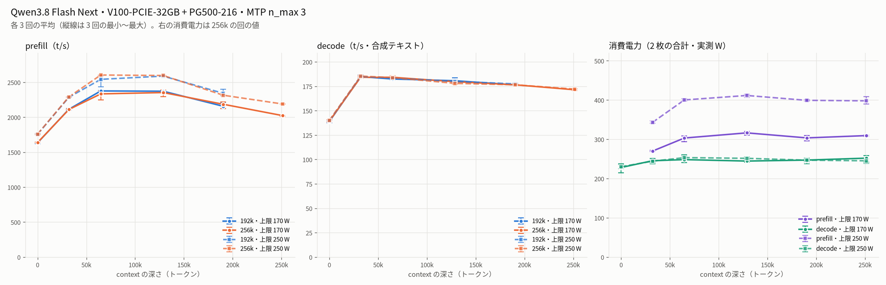

# Tesla V100-PCIE-32GB と PG500-216 で Qwen3.8 Flash Next を 192k / 256k で計測（最終構成・電力上限 170 W / 250 W）

- **作成者**: warabii
- **作成日**: 2026-10-16

## 概要

NVLink なしの V100-PCIE-32GB と PG500-216（各 32 GB）の 2 枚（GPU 間の P2P は使わない）で Qwen3.8 Flash Next（GGUF 80 GiB）を動かし、192k と 256k のコンテキストで prefill / decode を測りました。電力上限は 170 W と 250 W の 2 通りで、消費電力も実測しています。
全層を GPU に置いた layer 分割で pipeline 並列を使う構成です。使っている llama.cpp には自作の変更を加えています（差分は [qwen38-v100-patches](https://github.com/Warabii1248/qwen38-v100-patches) の版 `pcie-20261016` として公開しています）。前の版 `pcie-20261006` から足した項目のうち、この構成で使っているのは、decode を速くする変更 4 つ（2 枚の GPU で下書きの検証を重ねる lookahead、線形注意の層の前半・後半をそれぞれ 1 本のカーネルで計算する op など）と、プロンプトキャッシュの NVMe への退避です。

| 電力上限 | prefill（depth 32k〜190k） | prefill（depth 250k） | decode（合成テキスト・depth 32k〜250k） | decode（実プロンプト・temp 0.7） | 消費電力（2 枚の合計・prefill / decode） |
|------|------:|------:|------:|------:|------:|
| 170 W | 2110.8〜2376.2 t/s | 2022.8 t/s | 171.4〜184.8 t/s | 92.5〜123.5 t/s | 269〜319 W / 228〜253 W |
| 250 W | 2285.9〜2604.1 t/s | 2189.1 t/s | 172.1〜185.4 t/s | 94.2〜124.9 t/s | 342〜413 W / 221〜253 W |

値はどれも 192k と 256k の各 3 回の平均で、範囲は depth・context・プロンプトの違いによるものです。合成テキストの decode は 170 W と 250 W でほぼ同じ（同じ段どうしの差 1.0% 以内）で、decode の間はどちらの上限でも電力上限による減速が一度も出ていません。prefill は 170 W では電力上限に当たっていて、250 W にすると同じ段で 5.9〜11.6% 速くなりますが、1 トークンあたりの電力量は 16.5〜24.2% 増えます（192k・256k の同じ段どうし。下の消費電力の表の prefill J/token から計算）。

このレポートは [#45](https://github.com/jimoto-no-llm/bench-of-us/pull/45) の [2026-10-03 のレポート](2026-10-03_122722_profiling_qwen3.8_flash_next_at_192k_and_256k_on_tesla_v100_pcie_and_pg500_216.md) の続編で、同じ PC・モデル・ツールで、ctx / stages・KV キャッシュ・投機的デコードの引数（`--spec-type draft-mtp --spec-draft-n-max 3 --spec-draft-sampling probabilistic`）も同じにして測り直したものです。前回と同じ電力上限 250 W で比べると、prefill（depth 32k〜190k）は 1,070〜1,151 → 2,286〜2,604 t/s（同じ段どうしで 2.0〜2.3 倍）、合成テキストの decode（depth 32k〜250k）は 115〜122 → 172〜185 t/s（同じ段どうしで 1.5〜1.6 倍。1.6 倍は前回の値が低かった 256k の depth 32k で、ほかの段は 1.5 倍）になりました。前回との主な違いは、llama.cpp の変更（前回は未公開の版。ビルドの `GGML_SCHED_MAX_COPIES` も 2 → 既定の 4）と、`--batch-size` / `--ubatch-size`（8192 / 512 → 15360 / 1536）・MTP の環境変数（`LLAMA_MTP_N_UBATCH` / `LLAMA_MTP_PAD` 32 / 5 → 128 / 0、lookahead〔`LLAMA_LOOKAHEAD=1`〕などの追加）・その他の環境変数などの起動の設定です（OS のカーネルも 7.0.0-34 → 7.0.0-38）。

## ハードウェア

| 項目 | 内容 |
|------|------|
| コンピュータ / マザーボード | 自作 PC（MSI MPG X570 GAMING EDGE WIFI（MS-7C37）） |
| GPU | Tesla V100-PCIE-32GB ＋ Tesla PG500-216（各 1 枚・VRAM 32 GB / 枚。画面出力用の GeForce GTX 750 Ti は計測に使っていません） |
| GPU 接続 | PG500-216 は PCIe Gen3 x16、V100 は PCIe Gen3 x4（チップセット側のスロットで電気的に x4。GPU 自体は x16 対応）。NVLink なし（`nvidia-smi topo -m` で PHB）。GPU 間の P2P は使っていません（`GGML_CUDA_P2P` を設定していない） |
| CPU | AMD Ryzen 7 5700X3D（8 コア / 16 スレッド） |
| メモリ | 30 GiB（`free -h`）。DDR4 3000MHz |
| 電源 | 650 W |

## ソフトウェア環境

| 項目 | 内容 |
|------|------|
| OS | Ubuntu 26.04.1 LTS / Linux 7.0.0-38-generic |
| GPU ドライバ | 580.178.04（CUDA 13.0）。ビルドは CUDA Toolkit 12.9.86 |
| llama.cpp | 0.5.0（7fe450e）に pentacoxian 氏の `qwen4exp` 対応パッチ（v3）を当て、その上に公開差分 [qwen38-v100-patches](https://github.com/Warabii1248/qwen38-v100-patches) の版 `pcie-20261016`（56 項目）を当てたもの（公開したツリーと計測したツリーはバイト単位で同じ。README の Files）。CUDA バックエンド（`CMAKE_CUDA_ARCHITECTURES=70`）。ビルドは別の PC の WSL（Ubuntu 24.04.4・g++ 13.3.0・CUDA Toolkit 12.9.86）で `-DGGML_CUDA_NCCL=ON`（NCCL あり）・`-DGGML_NATIVE=OFF`・`-march=znver3`・Release・Ninja。`GGML_SCHED_MAX_COPIES` は既定の 4（公開差分の README のビルド例は 2）。起動用の `llama-server` の sha256 は run-info.json に記録（共有ライブラリ〔libggml-cuda.so など〕の sha256 は含みません） |

## ベンチマーク

### 条件

| 項目 | 内容 |
|------|------|
| ツール | llama-split-bench 7af72d4（変更なし） |
| モデル | Qwen3.8-Flash-Next-IQ3E-Q8D-MTP.gguf（80.0 GiB、アーキテクチャ `qwen4exp`）＋ mmproj-F16（862 MiB、`MTMD_ON_DEMAND=1` で画像のときだけ GPU に載せる設定。ベンチでは画像を使っていません） |
| 測定モード | profile（CUDA0+CUDA1・layer 分割）。電力上限 170 W と 250 W のそれぞれで context ごとに 3 回、計 12 回（192k → 256k の組を 170 W と 250 W で交互に 3 周）。結果は 3 回の平均 |
| ctx / stages | 192k: 196608 / 0,32000,64000,128000,190000。256k: 262144 / 0,32000,64000,128000,190000,250000 |
| ラダー | 各段は前の段のプロンプトを伸ばしたもので、前の段までの分の大部分はキャッシュから再利用されます。表の prefill は各段で新しく足した分（depth 32k・64k の段は約 3.2〜3.4 万トークン、128k 以降の段は約 6.7 万トークン）を処理した速さで、depth の値は段のプロンプトの長さ（生成の前）です（results-profile.json の `effective_depth`・`prompt_n`・`cache_n`）。decode は各段のプロンプトの後に 1000 トークンを生成した速さです |
| KV キャッシュ | q8_0 / q8_0 |
| 投機的デコード | `--spec-type draft-mtp --spec-draft-n-max 3 --spec-draft-sampling probabilistic` |
| 電力上限 | 170 W（普段の運用の値）と 250 W（既定・最大）。両 GPU とも同じ値。消費電力は上限ではなく実測の値を載せています（下の「消費電力の測り方」） |
| その他 | `-ngl 99 --fit off --tensor-split 26,24`、`--batch-size 15360 --ubatch-size 1536`、`-fa on`、`-t 8 --threads-batch 16`、`--load-mode mmap`、`--reasoning off`、生成 1000 トークン / 段。256k だけ `--cache-ram 12288`（192k はツールの既定の 8192）。環境変数は argv-*.txt を参照 |

普段の運用（llama-server のルーター経由）との違いは、思考（運用は on・effort medium）、`min-p`（運用は 0、ベンチはサーバーの既定 0.05。温度 0.7 の実プロンプトの測定だけに関係します）、ツールが付ける `--cache-reuse 256`・`--cache-idle-slots`・`--spec-draft-device CUDA0,CUDA1` です。argv-profile.txt にはツールの既定の `--ubatch-size 512`・`--cache-ram 8192` の後にこの構成の `--ubatch-size 1536`・（256k だけ）`--cache-ram 12288` が並んでいて、後の値が有効です（サーバーのログに「only last value will be used」）。ベンチの要求はテンプレートを通さない `/completion` なので、思考の設定は効きません。NVMe へのプロンプトキャッシュの退避先はベンチ専用のディレクトリにしました。

### 改造前からの変更点

改造前は、チューニングを始める前にこの PC で使っていた設定です（llama.cpp に自作の変更なし）。下の表にない引数・環境変数（KV q8_0・MTP の段数・スレッド数など）は改造前と同じです。モデルカードが推奨する環境変数（`GGML_CUDA_DISABLE_GRAPHS=1`・`LLAMA_GPU_ARGMAX=1` など）は改造前から設定していて、下の説明の一部はこれを前提にしています。argv-profile.txt では `LLAMA_MTP_N_UBATCH=32`・`LLAMA_MTP_PAD=5`（改造前の値）の後に `=128`・`=0` が並んでいて、後の値が有効です。

| 項目 | 改造前 | 本構成 |
|------|------|------|
| llama.cpp | 0.5.0 ＋ `qwen4exp` 対応パッチ（v3）＋ PR #29599 | 0.5.0 ＋ `qwen4exp` 対応パッチ（v3）＋ 公開差分 `pcie-20261016`（PR #29599・#27694・#29353 の移植、pentacoxian 氏の v4 の修正 1 件、自作の変更） |
| 層の置き場所 | `-ngl auto --fit on --fit-target 512`（llama.cpp が VRAM に合わせてテンソルの置き場所を決める。pipeline 並列は有効にならない） | `-ngl 99 --fit off --tensor-split 26,24`（全層 GPU・pipeline 並列が有効） |
| `--batch-size` / `--ubatch-size` | 2048 / 512 | 15360 / 1536 |
| 下書きのサンプリング | （オプションなし） | `--spec-draft-sampling probabilistic` |
| `LLAMA_MTP_N_UBATCH` / `LLAMA_MTP_PAD` | 32 / 5 | 128 / 0 |
| 追加した環境変数（`pcie-20261006` までの項目 01〜41 の分と、それに合わせた既存の設定〔`GGML_CUDA_MMQ_MOE_J=32` は v3 パッチのスイッチ、`CUDA_SCALE_LAUNCH_QUEUES=4x` は CUDA の設定〕） | — | MoE: `GGML_CUDA_MOE_F16TC=64`・`GGML_CUDA_MOE_F16TC_LAYOUT=1`・`GGML_CUDA_MOE_F16TC_FUSE=1`・`GGML_CUDA_MOE_TILE=1`・`GGML_CUDA_MMQ_MOE_PACK=1`・`GGML_CUDA_MMQ_MOE_J=32`／注意: `GGML_CUDA_GDN_CHUNK=1`・`GGML_CUDA_GDN_CHUNK_V=64`・`GGML_CUDA_QSA_DP4A=1`・`GGML_CUDA_QSA_HPW6=1`／pipeline 並列: `LLAMA_PP_PLAN_AHEAD=1`・`LLAMA_PP_PLAN_AHEAD_MAX_KV=0`・`LLAMA_PP_PLAN_HINT=1`・`LLAMA_QSA_CHUNK_TOKENS=64`・`LLAMA_QSA_CHUNK_FIXCOUNT=1`・`LLAMA_QSA_RESERVE_BLK=1`・`LLAMA_KV_PAD_GEO=2`・`LLAMA_PP_REUSE_MAX_TOKENS=16`・`GGML_SCHED_SYNC_INPUTS_MIN_TOKENS=64`・`GGML_CUDA_GRAPH_ALWAYS_MIN_TOKENS=64`・`LLAMA_PP_HC_NORM_DST=1`・`GGML_CUDA_PP_INPUT_BATCH=1`・`CUDA_SCALE_LAUNCH_QUEUES=4x`／MTP: `LLAMA_MTP_KV_ONLY=1`・`LLAMA_MTP_LAG=1`・`LLAMA_MTP_ASYNC=1`・`LLAMA_MTP_DRAFT_VOCAB`／decode: `GGML_CUDA_HC_PAR=1,1,3,5`・`LLAMA_SAMPLE_TOPK=1`・`LLAMA_GPU_TOPK=64`・`LLAMA_GPU_TOPK_MTP=0`／その他: `LLAMA_CKPT_TAIL_UBATCH=0`・`LLAMA_QSA_BLK_REBUILD=1` |
| 追加した環境変数（`pcie-20261016` で足した項目 42〜56 の分） | — | `LLAMA_LOOKAHEAD=1`・`LLAMA_DRAFT_AHEAD=4`・`GGML_CUDA_MOE_L2ORDER=1`・`LLAMA_PROMPT_CACHE_DISK`（＋`_MIB=65536`）・`LLAMA_A7_FFN_LAYERS`・`LLAMA_A7_ATTN_LAYERS`・`LLAMA_A7_ROUTE_REF=1`・`GGML_CUDA_Q6_K_T4_SMALLK=1` |

`pcie-20261006` までの変更の中身（MoE の行列積を Volta の FP16 テンソルコアで計算するカーネル、GDN の prefill の chunk 計算、QSA の 8 ビットの内積、pipeline 並列の重なりを保つための予約・同期の変更、MTP の追いつきの非同期化、decode の hyper-connection の並列化と top-k の GPU 化など）は、公開差分の README（Features の 01〜41）に項目ごとに書いています。`pcie-20261016` で足した項目 42〜56 のうち、この構成で有効にしているのは次の 5 つです（README の項目番号を括弧内に書きます。42〜44・48・49 は診断用、50 は top-k の結果を決定的にする修正で、この構成ではどれも設定していません。42〜56 はどれも環境変数で有効になり、設定しなければ `pcie-20261006` と同じ動きです）:

- **2 枚の GPU で下書きの検証を重ねる（項目 45〜47 と修正 51・52。lookahead・`LLAMA_LOOKAHEAD=1`・`LLAMA_DRAFT_AHEAD=4`）**: layer 分割の decode では、1 回の検証（本体が下書き 3 個＋1 個をまとめて計算する窓）が V100 の層 → PG500 の層と順に進むので、片方の GPU は半分の時間を待っています。窓 k の検証の結果を待たずに、窓 k の下書きがすべて受理されると仮定して次の窓 k+1 の前半（V100 側の層）を先に計算し、当たればそのまま後半へ進み、外れたら V100 側の線形注意の状態と KV を戻して捨てます。次の窓の下書きは MTP の連鎖を続けて作ります（`LLAMA_DRAFT_AHEAD=4`。1 窓前の状態から作るので受理率は少し下がります）。温度 > 0 では、窓 k の判定を下書き 4 個ぶんの棄却サンプリングで行い、出力の分布は変えません
- **MoE の decode の行列ベクトル積の起動順を L2 に合わせる（項目 53・`GGML_CUDA_MOE_L2ORDER=1`）**: 複数トークンの MoE の GEMV で、grid を行のタイルが最外になる順に替え、同じ専門家を選んだトークンが同じ重みのタイルを続けて読むようにします（1 ブロックの計算は同じ）
- **プロンプトキャッシュを NVMe に退避する（項目 54・`LLAMA_PROMPT_CACHE_DISK`）**: `--cache-ram` から追い出す会話の状態（本体・下書き・チェックポイント）のうち 64 MiB 以上のものを NVMe に書き、同じ会話が戻ってきたら読み戻します。このベンチの各段は前の段のプロンプトを伸ばしたもので、読み戻しは起きません（測定の値には関係しません）
- **decode の線形注意（GDN）の層を専用カーネルの op で計算する（項目 55・`LLAMA_A7_FFN_LAYERS`・`LLAMA_A7_ATTN_LAYERS`・`LLAMA_A7_ROUTE_REF=1`）**: 4 トークンの検証の窓（`--spec-draft-n-max 3`）で、GDN 層の前半（hyper-connection の混ぜ合わせ → q・k・v などの射影 → conv → L2 正規化 → delta rule → gated norm → 出力の射影）と後半（混ぜ合わせ → router → MoE → 共有専門家 → 戻し）を、それぞれ 1 つの op（GPU の SM の数だけのブロックが揃って段を進む 1 本のカーネル）に置き換え、多数の小さなカーネルの起動と待ちを減らします。対象は GDN の 36 層のうち前半 35 層（PG500 側の最初の層 26 を除く）・後半 35 層（FFN の重みが IQ3_S の層 2 を除く）で、除いた層は元の計算です。`LLAMA_A7_ROUTE_REF=1` は router の段で使う経路表の作り方の選択です。足し合わせの順番が元の経路と違うので、浮動小数の丸めが変わります（より精度の高い基準のモデルに対する llama-perplexity の測定で、この op の有無による差は、ツールが出す標準誤差の範囲でした。log-perplexity の差は誤差の 0.26 倍以下、KL の差は 0.5 倍以下）
- **出力ヘッドの Q6_K の行列積を検証の 4 行向けに（項目 56・`GGML_CUDA_Q6_K_T4_SMALLK=1`）**: 出力ヘッド（2,560 × 248,320・Q6_K）を 4 トークンで掛けるときに、warp 2 個・1 warp 4 行の配置の専用カーネルを使います。K 方向の足し合わせの順番が既定と違います

カーネルの正しさは、`pcie-20261006` までの分は公開差分の README に書いた方法（test-backend-ops・CPU の計算との比較・カーネル単体の出力のバイト一致など）、この構成で使っている 42〜56 の 5 つは元の経路との出力の比較で確かめています（自作の 9 問で、L2 の順は greedy の出力が 9/9 一致、出力ヘッドは 3 seed のサンプリングで 27/27 一致、lookahead は top-k を決定的にする 50 を設定した状態で greedy の出力が一致〔約 9,500・35,500 トークンのプロンプト〕し、取り消しの修正 51・52 の後は取り消しの後の回答も 9/9 一致、GDN の op は上の KL、NVMe への退避は `--cache-ram` から押し出した 49K トークンの会話をディスクから戻して同じ答え。README の Checks）。GDN の op の出力は lookahead の窓の中身にも左右されるので、lookahead と併用すると greedy の出力が別のプロセスどうし・同じプロセスの繰り返しで変わることがあります（サンプリングでは別のプロセスどうしで 27/27 一致）。

### 消費電力の測り方

- 計測中は別に `nvidia-smi --query-gpu=…,power.draw,power.limit,clocks.current.sm,clocks_event_reasons.active,… -lms 200` を動かし、V100 と PG500 の `power.draw` を 200 ms ごとに記録しました（添付の nvidia-smi-200ms.csv）。表の消費電力は、同じ読み取りの 2 枚の値を足したものの区間平均です。
- ツールが出力する各段の結果の行に、出力された時刻を付けました（20 ms ごとにログを読み、新しい行にその時刻を付ける）。各段・各実プロンプトの結果の行が出た時刻と、結果に含まれる時間・トークン数を、添付の stage-times.csv（`t_end_epoch` は UNIX 時刻。実プロンプトの行は生成トークン数と decode の速さだけで、時間の列は空）に抜き出しています。結果の行が出た時刻を T とし、結果に含まれる prefill の時間（`prompt_ms`）と decode の時間（`predicted_ms`）から、decode の区間を T − decode の時間 〜 T − 0.5 秒、prefill の区間を T − decode の時間 − prefill の時間 〜 T − decode の時間 − 0.5 秒としています（0.5 秒は境目の読み取りを避けるための余白）。実プロンプトは生成トークン数 ÷ decode の速さを decode の時間にしています。
- ラダー初段（depth 0）の prefill は 11 トークンで短すぎるため、消費電力を出していません。depth 0 の decode の消費電力は、この 11 トークンの後の生成のものです。
- 1 トークンあたりの電力量（J/token）は、区間平均の消費電力（W）÷ 同じ段の速さ（t/s）です（どちらも 3 回の平均。表の W・t/s は丸めた値なので、表から計算し直すと J/token の最後の桁が 1〜2 ずれることがあります）。170 W と 250 W の J/token の比は、表の J/token（prefill は小数 4 桁）から計算しています。
- 電力上限・温度による減速は、同じ記録の `clocks_event_reasons.active`（SW Power Cap、HW Slowdown、SW / HW Thermal Slowdown、HW Power Brake）で見ています。

### 結果

各電力上限・各 context 3 回の平均をまとめた図です。縦線は 3 回の最小〜最大です。右の消費電力は 256k の回の値です。
depth 0 の prefill は新規プロンプト（1,978 トークン）の値です。ラダー初段（11 トークン）の prefill は表に載せていません。

12 回は 2026-10-16 22:43 〜 10-17 00:29 に測りました。12 回とも起動用の `llama-server` の sha256 と引数は同じです（192k どうし・256k どうしで argv-profile.txt が一致）。

#### 電力上限 250 W

depth ごとの prefill / decode（t/s、3 回の平均）:

| depth | 192k prefill | 192k decode | 256k prefill | 256k decode |
|------:|------:|------:|------:|------:|
| 0 | 1756.2 | 139.8 | 1758.7 | 140.0 |
| 32k | 2285.9 | 185.0 | 2291.1 | 185.4 |
| 64k | 2542.3 | 183.4 | 2604.1 | 183.9 |
| 128k | 2588.3 | 180.1 | 2596.7 | 178.0 |
| 190k | 2342.0 | 177.4 | 2314.6 | 176.5 |
| 250k | — | — | 2189.1 | 172.1 |

3 回の最小〜最大（t/s）:

| depth | 192k prefill | 192k decode | 256k prefill | 256k decode |
|------:|------:|------:|------:|------:|
| 0 | 1750.2〜1764.7 | 138.8〜140.5 | 1757.4〜1760.1 | 139.0〜140.9 |
| 32k | 2281.1〜2290.5 | 183.8〜186.2 | 2286.5〜2296.4 | 185.0〜186.3 |
| 64k | 2436.7〜2595.2 | 181.6〜184.4 | 2599.1〜2606.8 | 182.9〜184.4 |
| 128k | 2585.1〜2591.5 | 178.6〜181.1 | 2592.9〜2599.2 | 176.8〜179.1 |
| 190k | 2305.6〜2398.2 | 177.0〜178.0 | 2311.3〜2317.2 | 176.5〜176.7 |
| 250k | — | — | 2187.5〜2190.9 | 172.0〜172.3 |

消費電力（2 枚の合計 W、3 回の平均）と 1 トークンあたりの電力量（J/token）:

| depth | 192k prefill W | 192k decode W | 256k prefill W | 256k decode W | 192k prefill J/token | 256k prefill J/token | 256k decode J/token |
|------:|------:|------:|------:|------:|------:|------:|------:|
| 0 | — | 221 | — | 230 | — | — | 1.64 |
| 32k | 342 | 245 | 343 | 244 | 0.1498 | 0.1497 | 1.32 |
| 64k | 384 | 246 | 400 | 253 | 0.1512 | 0.1537 | 1.38 |
| 128k | 413 | 247 | 412 | 252 | 0.1594 | 0.1585 | 1.41 |
| 190k | 402 | 248 | 399 | 247 | 0.1718 | 0.1725 | 1.40 |
| 250k | — | — | 398 | 245 | — | 0.1818 | 1.42 |

#### 電力上限 170 W

depth ごとの prefill / decode（t/s、3 回の平均）:

| depth | 192k prefill | 192k decode | 256k prefill | 256k decode |
|------:|------:|------:|------:|------:|
| 0 | 1634.0 | 138.8 | 1637.6 | 139.2 |
| 32k | 2114.4 | 184.8 | 2110.8 | 184.2 |
| 64k | 2376.2 | 182.5 | 2334.2 | 184.2 |
| 128k | 2372.2 | 180.7 | 2353.1 | 179.7 |
| 190k | 2156.6 | 176.5 | 2185.5 | 176.5 |
| 250k | — | — | 2022.8 | 171.4 |

3 回の最小〜最大（t/s）:

| depth | 192k prefill | 192k decode | 256k prefill | 256k decode |
|------:|------:|------:|------:|------:|
| 0 | 1621.2〜1645.4 | 137.7〜140.5 | 1632.2〜1647.3 | 138.5〜140.4 |
| 32k | 2098.7〜2127.1 | 183.2〜186.7 | 2105.5〜2117.8 | 183.4〜185.4 |
| 64k | 2369.4〜2382.5 | 182.2〜182.8 | 2250.7〜2376.8 | 182.3〜185.9 |
| 128k | 2368.0〜2378.7 | 178.3〜183.6 | 2295.9〜2386.5 | 178.0〜181.1 |
| 190k | 2124.8〜2213.0 | 176.2〜176.7 | 2125.9〜2217.3 | 176.0〜177.3 |
| 250k | — | — | 2016.2〜2026.3 | 170.8〜172.5 |

消費電力（2 枚の合計 W、3 回の平均）と 1 トークンあたりの電力量（J/token）:

| depth | 192k prefill W | 192k decode W | 256k prefill W | 256k decode W | 192k prefill J/token | 256k prefill J/token | 256k decode J/token |
|------:|------:|------:|------:|------:|------:|------:|------:|
| 0 | — | 230 | — | 228 | — | — | 1.64 |
| 32k | 269 | 243 | 270 | 245 | 0.1273 | 0.1279 | 1.33 |
| 64k | 308 | 245 | 303 | 248 | 0.1298 | 0.1299 | 1.35 |
| 128k | 319 | 253 | 316 | 245 | 0.1345 | 0.1345 | 1.36 |
| 190k | 304 | 247 | 304 | 247 | 0.1409 | 0.1389 | 1.40 |
| 250k | — | — | 309 | 252 | — | 0.1530 | 1.47 |

#### 新規プロンプト・実プロンプト・VRAM

depth 0 の新規プロンプト prefill（t/s、3 回の平均）:

| プロンプト長 | 170 W・192k | 170 W・256k | 250 W・192k | 250 W・256k |
|------:|------:|------:|------:|------:|
| 512 | 1069.8 | 1056.0 | 1112.5 | 1112.2 |
| 1978 | 1634.0 | 1637.6 | 1756.2 | 1758.7 |
| 8077 | 2000.5 | 2012.8 | 2128.8 | 2169.8 |

実プロンプト（3 種、temp 0.7 / top_p 0.9、1,200 トークン生成）の decode（t/s、3 回の平均。括弧内は最小〜最大、MTP の受理率の平均、decode の間の消費電力〔2 枚の合計〕の平均）:

| プロンプト | 170 W・192k | 170 W・256k | 250 W・192k | 250 W・256k |
|------|------:|------:|------:|------:|
| design | 110.2（103.3〜115.0・受理 54%・250 W） | 123.5（109.9〜144.4・受理 62%・244 W） | 124.9（116.8〜133.9・受理 62%・246 W） | 117.9（105.2〜131.4・受理 59%・249 W） |
| review | 93.1（91.4〜96.2・受理 44%・252 W） | 92.5（87.5〜98.7・受理 43%・251 W） | 95.2（93.3〜96.3・受理 45%・250 W） | 94.2（92.8〜95.5・受理 44%・251 W） |
| qa | 97.3（92.4〜103.1・受理 47%・250 W） | 96.1（95.1〜97.3・受理 46%・249 W） | 96.9（94.4〜101.5・受理 46%・251 W） | 98.4（96.8〜100.6・受理 47%・253 W） |

VRAM 使用量の最大（MiB、32,768 MiB 中・3 回の最大・results-profile.json の nvidia-smi の index 0 / 2。index 1 は GTX 750 Ti。170 W と 250 W で同じ値）:

| context | V100 | PG500 |
|------|------:|------:|
| 192k | 30788 | 30910 |
| 256k | 31296 | 31572 |

MTP のドラフト受理率は、ラダーの合成テキストでは depth 32k 以降で 96〜99%、depth 0（11 トークンのプロンプトの後の生成）では 76% でした。

### 所感

- **decode は合成テキストで 171.4〜185.4 t/s（depth 32k〜250k）、実プロンプトでは 92.5〜124.9 t/s でした（3 回の平均）**。170 W と 250 W の差は合成テキストの同じ段どうしで 1.0% 以内で、decode の間の消費電力も 2 枚の合計で 221〜253 W とほぼ同じでした。decode の間は 170 W でも電力上限による減速の記録が 0 回で、上限を上げても速くなりません
- depth 0 の decode が 139〜140 t/s と遅いのは、MTP の受理率が 76% と低いためと見ています（推定。11 トークンのプロンプトの後の生成で、受理率が低い理由は調べていません）
- **prefill は 170 W で depth 32k〜190k が 2,111〜2,376 t/s、250 W で 2,286〜2,604 t/s、256k の構成の depth 250k では 2,023 / 2,189 t/s でした**。170 W の prefill の区間では、200 ms ごとの読み取りの 61〜87%（回ごと・段ごとの値の範囲）で、どちらかの GPU に電力上限（SW Power Cap）による減速が出ていて、250 W では 0 回でした。250 W にすると同じ段で 5.9〜11.6% 速くなりますが、1 トークンあたりの電力量は 16.5〜24.2% 増えます（192k・256k の同じ段どうし。例: 256k の depth 128k で 0.1345 → 0.1585 J/token）
- 192k と 256k は同じ depth でほぼ同じ値で、context を広げても prefill・decode は遅くなりませんでした
- prefill の 3 回の差は多くの段で 1.5% 以内ですが、170 W の 192k の depth 190k（2,124.8・2,132.0 に対し 1 回 2,213.0）、256k の depth 64k（2,375.1・2,376.8 に対し 1 回 2,250.7）・128k（2,376.8・2,386.5 に対し 1 回 2,295.9）・190k（2,213.3・2,217.3 に対し 1 回 2,125.9）、250 W の 192k の depth 64k（2,594.8・2,595.2 に対し 1 回 2,436.7）・190k（2,305.6・2,322.1 に対し 1 回 2,398.2）は、3 回のうち 1 回だけが外れていました。原因は調べていません
- 実プロンプトの decode は、同じプロンプトでも回によって最大 34.4 t/s（256k の design・170 W）違いました。temp 0.7 で生成文が毎回変わり、MTP の受理率が回ごとに変わるためと見ています（推定）。170 W と 250 W の実プロンプトの差（design で 110.2 と 124.9 など）は受理率の差と同じ向きで、電力上限による差ではないと見ています（推定。decode の間は電力上限による減速の記録が 0 回）
- **VRAM は最大で PG500 が 31,572 MiB（256k・残り約 1.2 GiB）でした**。192k は 1 枚あたり約 1.8 GiB の余裕があります
- 温度・ハードウェアによる減速（HW Slowdown・SW / HW Thermal Slowdown・HW Power Brake）は 12 回とも一度も出ていません。200 ms ごとの読み取りでの 1 枚の消費電力の最大は、170 W で 218 W、250 W で 246 W でした。170 W では、6 回の記録の全期間（モデルの読み込み・待ち時間を含む）の 1 枚ごとの読み取りのうち 23% が上限を 1 W 以上超えていて（同じ GPU で続いた長さは最長で約 3 秒）、上限を超える値は一時的なものです。170 W の各段の区間平均（3 回の平均）は 2 枚の合計で最大 319 W（上限の合計 340 W）でした
- ツールの他プロセス検知は CUDA の番号を nvidia-smi の番号として扱うため、この PC では 2 枚目（PG500）の代わりに GTX 750 Ti を見ています。画面配信の Sunshine が起動時から GTX 750 Ti に CUDA の文脈を持っていて検知に掛かるため、計測中は Sunshine を止めました。計測中はほかの GPU 処理は動かしていません。改造したカーネルを通ったことは、各回のサーバーのログ（MoE・GDN・QSA・タイル・融合・境目の転送・lookahead・GDN の op・出力ヘッドのカーネルの各経路が有効になったことを示す行）で確かめています

## 添付

- [bench-ja.png](attachment/2026-10-16_224624_profiling_qwen3.8_flash_next_at_192k_and_256k_on_tesla_v100_pcie_and_pg500_216_at_170w_and_250w/bench-ja.png) / [bench-en.png](attachment/2026-10-16_224624_profiling_qwen3.8_flash_next_at_192k_and_256k_on_tesla_v100_pcie_and_pg500_216_at_170w_and_250w/bench-en.png)（各電力上限・各 context 3 回の平均と最小〜最大、256k の回の消費電力）
- [numbers.json](attachment/2026-10-16_224624_profiling_qwen3.8_flash_next_at_192k_and_256k_on_tesla_v100_pcie_and_pg500_216_at_170w_and_250w/numbers.json)（速さ・消費電力・減速の割合の表と図の元の数値。回ごとの速さを含む。J/token はこのファイルの消費電力 ÷ 速さ〔どちらも 3 回の平均〕で、上限を超えた読み取りの割合は nvidia-smi-200ms.csv から出しています）。`dirs` の計測名は `fn<context>-HA9-pl<電力上限>-1016` に、2 回目は `-n2`、3 回目は `-n3` を付けたものです。250 W の 2 回目は途中で止まった計測の後に取り直したので `-n2c` です（途中で止まった計測の値は使っていません）。下のフォルダの 1〜3 回目に対応します
- 回ごとのフォルダ `170w-192k-1/` 〜 `250w-256k-3/`（電力上限・context・何回目）: run-info.json・results-profile.json・results-profile-pp0.json・results-real.json・argv-profile.txt・200 ms ごとの nvidia-smi の記録（nvidia-smi-200ms.csv。時刻は計測した PC の現地時刻〔UTC+9〕）・各段の結果が出た時刻（stage-times.csv）。消費電力の表の値は、この 2 つのファイルだけから計算し直せます。ツールが回ごとに出力する図は、実プロンプトの補正による推定の線が入るので添付していません。
  例: 170 W の 192k の [1 回目](attachment/2026-10-16_224624_profiling_qwen3.8_flash_next_at_192k_and_256k_on_tesla_v100_pcie_and_pg500_216_at_170w_and_250w/170w-192k-1/run-info.json)、
  250 W の 256k の [3 回目](attachment/2026-10-16_224624_profiling_qwen3.8_flash_next_at_192k_and_256k_on_tesla_v100_pcie_and_pg500_216_at_170w_and_250w/250w-256k-3/run-info.json)
- GPU の UUID は `GPU-<uuid>` に置き換えています。ホームディレクトリのパス・ユーザー名・ホスト名・IP アドレス（127.0.0.1 を除く）は含みません。nvidia-smi の記録と results-profile.json の `gpu_before` / `gpu_after` からは温度の値を除いています
