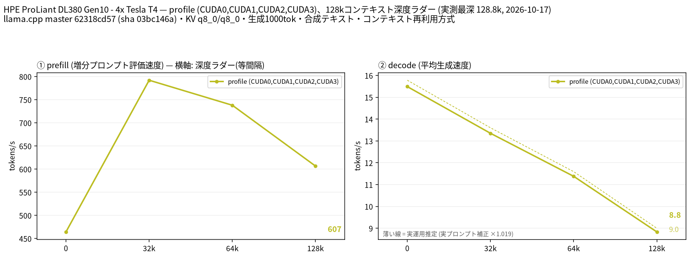
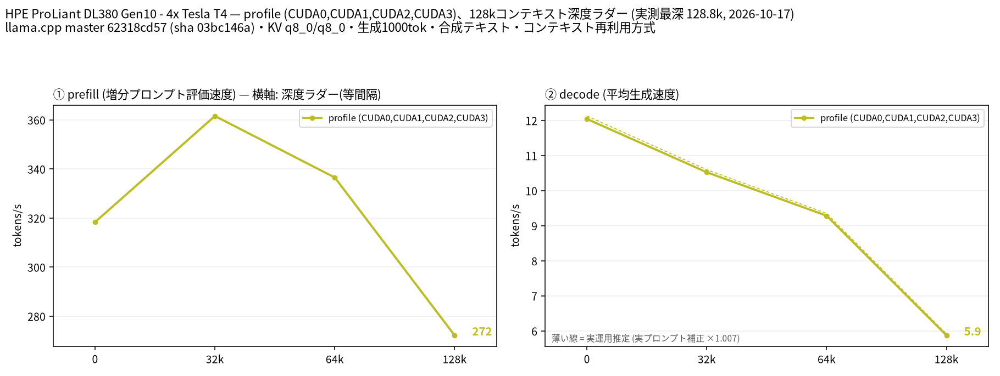

# Tesla T4 4 枚で Nemotron 3.5 Bolt 74B-A9B の IQ2_XXS と Q4_K_M を 128k コンテキストまで比較

- **作成者**: MG8853
- **作成日**: 2026-10-17

## 概要

HPE ProLiant DL380 Gen10 に Tesla T4 × 4（15 GB / 枚）を載せた構成で、NVIDIA Nemotron 3.5 Bolt 74B-A9B（総 74B / アクティブ 9B、アーキテクチャ `nemotron_h_moe`、88 ブロック、エキスパート 496 / 使用 9）の IQ2_XXS（20.5 GiB）と Q4_K_M（45.0 GiB）を、CUDA0〜CUDA3 の layer 分割で 128k コンテキストまで比較しました。テキスト入力のみで、投機的デコードは使っていません。
IQ2_XXS は 128k で prefill 606.6 t/s / decode 8.83 t/s、Q4_K_M は prefill 272.2 t/s / decode 5.87 t/s でした。この構成では、ファイルが 2.2 倍大きい Q4_K_M は decode で 18〜34% 遅く、prefill でも 31〜55% 遅い結果です。ただし Q4_K_M は出力層を CPU に置いた条件で、この差には出力層の CPU 計算も含まれます。
Q4_K_M は既定の layer 分割では 64k でも計算バッファの VRAM が足りず、`-ot output.weight=CPU` で出力層を CPU に逃がして初めて 128k で起動できました（CUDA3 の使用量は 14.5 GiB）。

## ハードウェア

| 項目 | 内容 |
|------|------|
| コンピュータ / マザーボード | HPE ProLiant DL380 Gen10 |
| GPU | Tesla T4 × 4（VRAM 15,360 MiB / 枚、電力上限 70 W / 枚） |
| GPU 接続 | PCIe 3.0 x16（`nvidia-smi` の current はアイドル時 Gen1 x16、max は Gen3 x16）。NVLink なし。`nvidia-smi topo -m` では GPU0-GPU1 が NODE、GPU2-GPU3 が NODE、この 2 組の間は SYS（NUMA ノードをまたぐ） |
| CPU | Intel Xeon Gold 6254 × 2（18 コア / 36 スレッド × 2。この環境でオンラインなのは 36 論理 CPU） |
| メモリ | 232 GiB |
| 電源 | 不明 |

## ソフトウェア環境

| 項目 | 内容 |
|------|------|
| OS | Ubuntu 26.04.1 LTS / Linux 7.0.14-14-pve |
| GPU ドライバ | 615.71.09（CUDA UMD 13.4） |
| llama.cpp | master 62318cd57（version 0.7.0-dev build 11709、2026-10-17）、CUDA バックエンド（CUDA 13.2、`CMAKE_CUDA_ARCHITECTURES=75`、`GGML_CUDA_FA=ON`、`GGML_CUDA_FA_ALL_QUANTS=ON`、`GGML_CUDA_NCCL=ON`、Release / GCC 15.2.0） |

## ベンチマーク

### 条件

| 項目 | 内容 |
|------|------|
| ツール | llama-split-bench 7af72d4 |
| モデル | `unsloth/NVIDIA-Nemotron-3.5-Bolt-74B-A9B-GGUF` の IQ2_XXS（22,018,326,464 バイト = 20.5 GiB）と `darioooooo0o/NVIDIA-Nemotron-3.5-Bolt-74B-A9B-GGUF` の Q4_K_M（2 シャード計 48,341,642,336 バイト = 45.0 GiB）。総 74B / アクティブ 9B の MoE（`nemotron_h_moe`、88 ブロック、エキスパート 496 / 使用 9、GGUF 上のコンテキスト長 262,144） |
| 測定モード | profile（CUDA0〜CUDA3 の 4 枚、layer 分割）。モデルが T4 1 枚（15 GB）に収まらないため単一 GPU の比較はしていません（`VS_PANEL=off`） |
| ctx / stages | 131072 / 0,32000,64000,128000 |
| KV キャッシュ | q8_0 / q8_0 |
| 投機的デコード | なし（`SPEC_ARGS=""`） |
| その他 | テキストのみ（`--mmproj` なし。画像入力は未計測）、`-fa on`、`-ngl all`、`-t 16`、`--parallel 1`、`--jinja`、`--cache-ram 8192 --cache-idle-slots`、生成 1000 トークン / 段、PORT 18081、`LAUNCH_PREFIX` なし |
| Q4_K_M の追加設定 | `-ot output.weight=CPU`（出力層のみ CPU）。この設定がないと 128k でも 64k でも CUDA3 の計算バッファ確保に失敗しました |

### 結果（IQ2_XXS、20.5 GiB、128k）

単位は t/s です。depth 0 の prefill は新規プロンプト（pp2048）の値です。ラダー初段（11 トークン）の prefill は計測上のアーティファクトなので表に載せていません。

| depth | prefill | decode |
|------:|------:|------:|
| 0 | 464.3 | 15.49 |
| 32k | 792.1 | 13.35 |
| 64k | 738.0 | 11.38 |
| 128k | 606.6 | 8.83 |

### 結果（Q4_K_M、45.0 GiB、128k、出力層 CPU）

| depth | prefill | decode |
|------:|------:|------:|
| 0 | 318.3 | 12.04 |
| 32k | 361.6 | 10.52 |
| 64k | 336.5 | 9.28 |
| 128k | 272.2 | 5.87 |

### 所感

- decode は IQ2_XXS が全深度で速く、depth 0 で 15.49 対 12.04 t/s、128k で 8.83 対 5.87 t/s でした。T4 のメモリ帯域は 320 GB/s で、decode は重みの読み出し量の影響を受けます。ただし Q4_K_M だけ出力層を CPU に置く追加設定があるため、この差を量子化だけに帰属することはできません。少なくともこの CPU オフロード構成では、Q4_K_M に速度の利点はありませんでした。
- prefill も IQ2_XXS が速く、32k で 792.1 対 361.6 t/s、128k で 606.6 対 272.2 t/s でした。Q4_K_M は 4-bit の dequant、出力層の CPU 計算、CUDA3 がほぼ満杯で計算バッファの余裕がないことが影響していると考えられます。
- **Q4_K_M は 128k で既定の配置のままでは起動できませんでした。** 128k では CUDA3 の計算バッファ（約 397 MiB）の確保に失敗し、64k でも約 181 MiB の確保に失敗しました。`-ot output.weight=CPU` で出力層（語彙 × 埋め込み）を CPU に移すと 128k で起動し、CUDA3 の使用量は 14.5 GiB でした。T4 4 枚で Q4_K_M を長いコンテキストで使う場合の実用的な回避策です。
- IQ2_XXS は既定の配置で 128k が起動し、CUDA3 の使用量は 7.3 GiB でした。VRAM にはまだ余裕があり、より長いコンテキストも試せます。
- 実プロンプト補正係数は IQ2_XXS 1.019、Q4_K_M 1.007 で、どちらもほぼ 1 です。合成ラダーの decode 値がそのまま実運用の目安になります。
- このモデルは image-text-to-text ですが、今回はテキスト入力のみで、mmproj は読み込んでいません。画像入力の速度は未計測です。

## 添付

- IQ2_XXS
  - [run-info.json](attachment/2026-10-17_225649_comparing_iq2_xxs_and_q4_k_m_of_nemotron_3.5_bolt_74b_a9b_on_4x_tesla_t4/iq2_xxs/run-info.json)
  - [results-profile.json](attachment/2026-10-17_225649_comparing_iq2_xxs_and_q4_k_m_of_nemotron_3.5_bolt_74b_a9b_on_4x_tesla_t4/iq2_xxs/results-profile.json) / [results-profile-pp0.json](attachment/2026-10-17_225649_comparing_iq2_xxs_and_q4_k_m_of_nemotron_3.5_bolt_74b_a9b_on_4x_tesla_t4/iq2_xxs/results-profile-pp0.json) / [results-real.json](attachment/2026-10-17_225649_comparing_iq2_xxs_and_q4_k_m_of_nemotron_3.5_bolt_74b_a9b_on_4x_tesla_t4/iq2_xxs/results-real.json)
  - [argv-profile.txt](attachment/2026-10-17_225649_comparing_iq2_xxs_and_q4_k_m_of_nemotron_3.5_bolt_74b_a9b_on_4x_tesla_t4/iq2_xxs/argv-profile.txt)
- Q4_K_M
  - [run-info.json](attachment/2026-10-17_225649_comparing_iq2_xxs_and_q4_k_m_of_nemotron_3.5_bolt_74b_a9b_on_4x_tesla_t4/q4_k_m/run-info.json)
  - [results-profile.json](attachment/2026-10-17_225649_comparing_iq2_xxs_and_q4_k_m_of_nemotron_3.5_bolt_74b_a9b_on_4x_tesla_t4/q4_k_m/results-profile.json) / [results-profile-pp0.json](attachment/2026-10-17_225649_comparing_iq2_xxs_and_q4_k_m_of_nemotron_3.5_bolt_74b_a9b_on_4x_tesla_t4/q4_k_m/results-profile-pp0.json) / [results-real.json](attachment/2026-10-17_225649_comparing_iq2_xxs_and_q4_k_m_of_nemotron_3.5_bolt_74b_a9b_on_4x_tesla_t4/q4_k_m/results-real.json)
  - [argv-profile.txt](attachment/2026-10-17_225649_comparing_iq2_xxs_and_q4_k_m_of_nemotron_3.5_bolt_74b_a9b_on_4x_tesla_t4/q4_k_m/argv-profile.txt)
