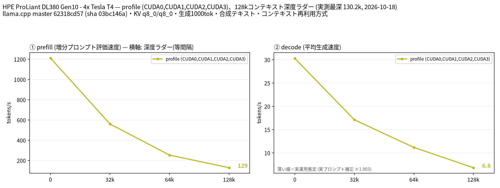

# Tesla T4 4 枚で GLM-4.7-Flash Q6_K を 128k コンテキストまで計測

- **作成者**: MG8853
- **作成日**: 2026-10-18

## 概要

HPE ProLiant DL380 Gen10 に Tesla T4 × 4（15 GB / 枚）を載せた構成で、GLM-4.7-Flash の Q6_K（unsloth、23.0 GiB）を CUDA0〜CUDA3 の layer 分割で 128k コンテキストまで計測しました。テキスト入力のみ、投機的デコードなしの条件です。
短いコンテキストでは非常に速く、depth 0 で decode 30.30 t/s、prefill（pp2048）1212.2 t/s でした。128k では decode 6.82 t/s、prefill 129.0 t/s まで低下しますが、T4 4 枚で 128k を扱えることを確認しました。VRAM は最大 7.6 GiB / 枚で、4 枚合わせても 60 GiB の半分程度です。

## ハードウェア

| 項目 | 内容 |
|------|------|
| コンピュータ / マザーボード | HPE ProLiant DL380 Gen10 |
| GPU | Tesla T4 × 4（VRAM 15,360 MiB / 枚、電力上限 70 W / 枚） |
| GPU 接続 | PCIe 3.0 x16（`nvidia-smi` の current はアイドル時 Gen1 x16、max は Gen3 x16）。NVLink なし。`nvidia-smi topo -m` では GPU0-GPU1 が NODE、GPU2-GPU3 が NODE、この 2 組の間は SYS（NUMA ノードをまたぐ） |
| CPU | Intel Xeon Gold 6254 × 2（18 コア / 36 スレッド × 2。この環境でオンラインなのは 36 論理 CPU） |
| メモリ | 232 GiB |
| 電源 | 不明 |

## ソフトウェア環境

| 項目 | 内容 |
|------|------|
| OS | Ubuntu 26.04.1 LTS / Linux 7.0.14-14-pve |
| GPU ドライバ | 615.71.09（CUDA UMD 13.4） |
| llama.cpp | master 62318cd57（version 0.7.0-dev build 11709、2026-10-17）、CUDA バックエンド（CUDA 13.2、`CMAKE_CUDA_ARCHITECTURES=75`、`GGML_CUDA_FA=ON`、`GGML_CUDA_FA_ALL_QUANTS=ON`、`GGML_CUDA_NCCL=ON`、Release / GCC 15.2.0） |

## ベンチマーク

### 条件

| 項目 | 内容 |
|------|------|
| ツール | llama-split-bench 7af72d4 |
| モデル | `unsloth/GLM-4.7-Flash-GGUF` の Q6_K（24,693,098,848 バイト = 23.0 GiB）。アーキテクチャ `deepseek2`、47 ブロック、エキスパート 64 / 使用 4、GGUF 上のコンテキスト長 202,752 |
| 測定モード | profile（CUDA0〜CUDA3 の 4 枚、layer 分割）。モデル（23.0 GiB）は T4 1 枚（15 GiB）に収まらないため、単一 GPU の比較はしていません（`VS_PANEL=off`） |
| ctx / stages | 131072 / 0,32000,64000,128000 |
| KV キャッシュ | q8_0 / q8_0 |
| 投機的デコード | なし（`SPEC_ARGS=""`） |
| その他 | テキストのみ（`--mmproj` なし）、`-fa on`、`-ngl all`、`-t 16`、`--parallel 1`、`--jinja`、`--cache-ram 8192 --cache-idle-slots`、生成 1000 トークン / 段（128k 段はコンテキスト上限に達し 916 トークン）、PORT 18081、`LAUNCH_PREFIX` なし |

### 結果

単位は t/s です。depth 0 の prefill は新規プロンプト（pp2048）の値です。ラダー初段（11 トークン）の prefill は計測上のアーティファクトなので表に載せていません。128k 段の decode は、実効深度 130,156 トークンと生成分の合計が ctx 131,072 に達するため 916 トークンでの測定です（生成上限は 1,000 トークン）。

| depth | prefill | decode |
|------:|------:|------:|
| 0 | 1212.2 | 30.30 |
| 32k | 560.6 | 17.11 |
| 64k | 253.9 | 11.18 |
| 128k | 129.0 | 6.82 |

### 所感

- depth 0 の decode 30.30 t/s、prefill 1212.2 t/s は、この 4×T4 環境で計測したモデルの中では最も速い部類です。アクティブパラメータが少ない MoE と、KV キャッシュの小さい `deepseek2`（MLA）系の attention が効いていると考えられます。
- コンテキストが深くなるにつれて速度は大きく落ちます。32k で decode 17.11 / prefill 560.6、64k で 11.18 / 253.9、128k で 6.82 / 129.0 t/s でした。特に prefill は 32k 以降で半分以下になっており、長いプロンプトを読む用途では 128k は覚悟が必要です。
- 実プロンプト補正係数は 1.003 で、合成ラダーの decode 値がそのまま実運用の目安になります。
- VRAM は 128k 確保時で最大 7.6 GiB / 枚でした。T4 4 枚の 60 GiB に対して余裕があり、このモデルは 4 枚構成で扱いやすい部類です。
- GGUF メタデータ上のコンテキスト長は 202,752 ですが、今回は 128k までを計測しています。MTP ヘッドの有無は確認しておらず、投機的デコードは使っていません。
- モデルは 23.0 GiB で、T4 1 枚（15 GiB）には収まりません。単一 GPU で動かすには CPU オフロードなどの別条件が必要で、今回は比較していません。

## 添付

- [run-info.json](attachment/2026-10-18_005555_profiling_glm_4.7_flash_q6_k_on_4x_tesla_t4/run-info.json)
- [results-profile.json](attachment/2026-10-18_005555_profiling_glm_4.7_flash_q6_k_on_4x_tesla_t4/results-profile.json) / [results-profile-pp0.json](attachment/2026-10-18_005555_profiling_glm_4.7_flash_q6_k_on_4x_tesla_t4/results-profile-pp0.json) / [results-real.json](attachment/2026-10-18_005555_profiling_glm_4.7_flash_q6_k_on_4x_tesla_t4/results-real.json)
- [argv-profile.txt](attachment/2026-10-18_005555_profiling_glm_4.7_flash_q6_k_on_4x_tesla_t4/argv-profile.txt)
