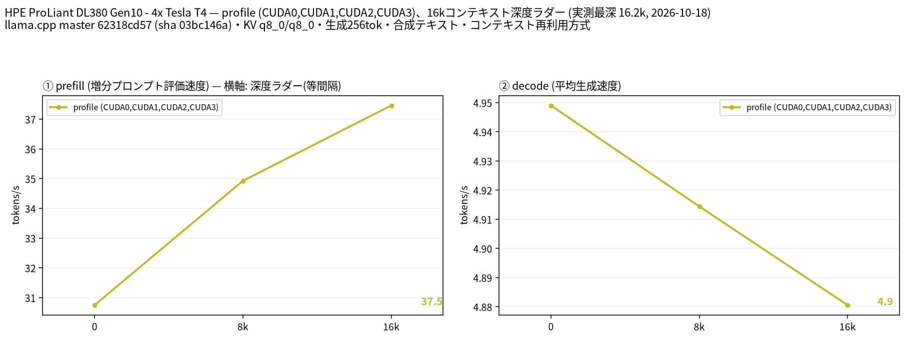

# Tesla T4 4 枚で GLM-5.3-Flash UD-IQ3_XXS を llama.cpp（全エキスパート CPU）と ProjectMaya で比較

- **作成者**: MG8853
- **作成日**: 2026-10-18

## 概要

HPE ProLiant DL380 Gen10 に Tesla T4 × 4（15 GB / 枚）を載せた構成で、GLM-5.3-Flash（321B / アクティブ 18B、アーキテクチャ `glm5-next`、46 ブロック、エキスパート 288 / 使用 8）の同じ UD-IQ3_XXS（120.4 GB = 112.1 GiB）を、llama.cpp と ProjectMaya の 2 つのエンジンで計測しました。
llama.cpp は `-cmoe`（全 MoE エキスパートを CPU）で 16k コンテキスト、ProjectMaya v1.1.15 は VRAM / RAM / SSD のエキスパート階層で 32k コンテキストです。同じ GGUF を使って、llama.cpp は decode 4.95 t/s・prefill 34.9 t/s（8k）でしたが、ProjectMaya は decode 平均 22.8 t/s・prefill 222 t/s（8k）でした。ProjectMaya は decode で約 4.6 倍、prefill で約 6.4 倍速く、T4 4 枚で 321B モデルを実用的に動かせることを確認しました。

## ハードウェア

| 項目 | 内容 |
|------|------|
| コンピュータ / マザーボード | HPE ProLiant DL380 Gen10 |
| GPU | Tesla T4 × 4（VRAM 15,360 MiB / 枚、電力上限 70 W / 枚） |
| GPU 接続 | PCIe 3.0 x16（`nvidia-smi` の current はアイドル時 Gen1 x16、max は Gen3 x16）。NVLink なし。`nvidia-smi topo -m` では GPU0-GPU1 が NODE、GPU2-GPU3 が NODE、この 2 組の間は SYS（NUMA ノードをまたぐ） |
| CPU | Intel Xeon Gold 6254 × 2（18 コア / 36 スレッド × 2。この環境でオンラインなのは 36 論理 CPU） |
| メモリ | 232 GiB |
| 電源 | 不明 |

## ソフトウェア環境

| 項目 | 内容 |
|------|------|
| OS | Ubuntu 26.04.1 LTS / Linux 7.0.14-14-pve |
| GPU ドライバ | 615.71.09（CUDA UMD 13.4） |
| llama.cpp | master 62318cd57（version 0.7.0-dev build 11709、2026-10-17）、CUDA バックエンド（CUDA 13.2、`CMAKE_CUDA_ARCHITECTURES=75`、`GGML_CUDA_FA=ON`、`GGML_CUDA_FA_ALL_QUANTS=ON`、`GGML_CUDA_NCCL=ON`、Release / GCC 15.2.0） |
| ProjectMaya | v1.1.15（commit a4e1ff0、2026-10-16）、CUDA 13.2 でビルド。llama.cpp の pinned commit を取り込んだ独自エンジン |

## ベンチマーク

### 条件

| 項目 | llama.cpp | ProjectMaya |
|------|------|------|
| ツール | llama-split-bench 7af72d4 | `./maya.sh --bench`（ProjectMaya 標準ベンチ） |
| モデル | `unsloth/GLM-5.3-Flash-GGUF` の UD-IQ3_XXS（4 シャード計 120,367,571,840 バイト = 112.1 GiB）。`glm5-next`、46 ブロック、エキスパート 288 / 使用 8、コンテキスト長 1,048,576 | 同じ UD-IQ3_XXS の GGUF を `--gguf-dir` で読み込み、ProjectMaya の pack（索引）を作成して使用。エンジンログでは NextN（MTP）ブロックがロードされ、投機的デコードが有効 |
| 測定モード | profile（CUDA0〜CUDA3 の 4 枚、layer 分割）。`-cmoe` で全 MoE エキスパートを CPU に配置 | 4 GPU（0,1,2,3）の layer 分割。エキスパートは VRAM / RAM / SSD の階層に自動配置（`--expert-cache auto`） |
| ctx / stages | 16384 / 0,8000,16000、生成 256 トークン / 段（16k 段はコンテキスト上限に達し 171 トークン） | 32768、decode は 256 トークン × 3 問、prefill は 2048 / 8192 トークン |
| KV キャッシュ | q8_0 / q8_0 | エンジン既定（KV streaming on、32k で 0.12〜0.20 GB / GPU） |
| 投機的デコード | なし（`SPEC_ARGS=""`） | **MTP（NextN）を使用**。添付の標準ベンチログには採択率の行がないため、`the draft layer 120` とプール前使用量の `other (context, MTP, scratch, prompt path)` の記録で有効を確認 |
| その他 | テキストのみ、`-fa on`、`-ngl all`、`-t 16`、`--parallel 1`、`--jinja`、`--cache-ram 8192 --cache-idle-slots`、`--no-real`（実プロンプト補正なし）、PORT 18081 | テキストのみ（`--no-vision`）、greedy・thinking off、`--prefill auto`、`--kv-streaming on`、RAM 232 GB |

### 結果（llama.cpp `-cmoe` 16k / ProjectMaya 32k）

単位は t/s です。llama.cpp の depth 0 の prefill は新規プロンプト（pp2048）の値です。ラダー初段（11 トークン）の prefill は計測上のアーティファクトなので表に載せていません。実プロンプト補正は行っていません（`--no-real`）。

ProjectMaya の decode は depth 別の計測ではなく、32k 設定で 256 トークンを生成した 3 問の平均です（短いプロンプト）。比較的近い 2k 行に代表値として載せ、8k / 16k は未計測としています。prefill は 2k / 8k の実測値です。

| depth | llama.cpp prefill | llama.cpp decode | ProjectMaya prefill | ProjectMaya decode |
|------:|------:|------:|------:|------:|
| 2k | 30.8 | 4.95 | 180 | 22.8 |
| 8k | 34.9 | 4.91 | 222 | 未計測 |
| 16k | 37.5 | 4.88 | 未計測 | 未計測 |

llama.cpp の 16k 段の decode は、プロンプト 16,213 トークンと生成分の合計が ctx 16,384 に達するため 171 トークンでの測定です（生成上限は 256 トークン）。

### 結果（ProjectMaya v1.1.15、32k の詳細）

ProjectMaya の標準ベンチは、同じ 3 問を greedy・thinking off で 256 トークンずつ生成し、2048 / 8192 トークンのプロンプトを読む条件です。

| 項目 | 値 |
|------|------:|
| decode（3 問の平均） | 22.8 t/s |
| decode（各問） | 22.9 / 22.3 / 23.3 t/s |
| prefill（2048 トークン） | 180 t/s |
| prefill（8192 トークン） | 222 t/s |
| モデルロード時間 | 添付の標準ベンチログに記録がないため未記載 |
| VRAM 使用量 | エキスパートプール 11.2〜11.9 GB / GPU + プール前 2.0〜2.7 GB（ログ上の各 GPU 合計 14.58 GB、残り約 0.7 GB） |
| RAM に pin したエキスパート | 16.8〜18.5 GB / GPU（合計約 70 GB） |
| VRAM ヒット率 | 72.9〜75.5%（4 回の `glm stat`） |
| RAM からのエキスパート取得 | 8.8〜10.6 個 / トークン |
| SSD からの読み出し | 0.00 回 / トークン（ウォームアップ後） |

### エンジン間の比較

| 項目 | llama.cpp `-cmoe` | ProjectMaya |
|------|------:|------:|
| decode（短いコンテキスト） | 4.95 t/s | 22.8 t/s |
| prefill 2k | 30.8 t/s | 180 t/s |
| prefill 8k | 34.9 t/s | 222 t/s |
| VRAM / 枚 | 2.0〜3.5 GiB | 約 13.9 GB（エキスパートプール + プール前のログ内訳合計） |
| コンテキスト | 16k | 32k |
| 投機的デコード | なし | MTP（NextN） |

VRAM 使用量は、ProjectMaya が `glm fast:` 行に出すエキスパートプールとプール前使用量の合計（各 GPU 13.89〜13.90 GB / 14.58 GB）です。llama.cpp は `nvidia-smi` の MiB 値を 1024 で割って GiB に換算しました（2,099〜3,597 MiB）。

### 所感

- 同じ UD-IQ3_XXS の GGUF を使っても、エキスパートの置き方で速度が大きく変わります。llama.cpp の `-cmoe` は全エキスパートを CPU に置くため、VRAM は 2.0〜3.5 GiB / 枚しか使いませんが、decode 4.95 t/s・prefill 34.9 t/s（8k）にとどまりました。ProjectMaya は各 GPU に約 11 GB のエキスパートプールを持ち、ルーティングされたエキスパートの約 74% を VRAM から供給するため、decode 22.8 t/s・prefill 222 t/s（8k）と 4.6〜6.4 倍速い結果です。
- ProjectMaya は 232 GB の RAM をエキスパートの第 2 階層として使い、SSD からの読み出しはウォームアップ後 0.00 回 / トークンでした。VRAM に載らないエキスパートのうち毎トークン約 9〜11 個を RAM から取得し、CPU レーンで一部を計算しています。ディスクに落ちない構成にできることが、この速度の鍵です。
- llama.cpp 側は `-cmoe` という粗い設定での比較です。`--n-cpu-moe N` は「最初の N 層」のエキスパートを CPU に置くため、4 枚の layer 分割では後半の GPU にエキスパートが残って VRAM が足りず、部分オフロードの調整が難しいモデルでした。llama.cpp でより良い配置を探す余地はありますが、少なくとも「全エキスパート CPU」のベースラインとしてはこの値です。
- llama.cpp は投機的デコードなし、ProjectMaya は MTP（NextN）を使っています。ProjectMaya の decode 22.8 t/s は MTP による投機的デコードを含む値です（採択率は添付の標準ベンチログに記録されていません）。したがって llama.cpp の 4.95 t/s との差には、エキスパート配置だけでなく投機的デコードの有無も含まれます。エンジン単体の非投機デコード比較ではない点に注意してください。
- コンテキスト長は llama.cpp 16k、ProjectMaya 32k と異なります。短いコンテキストの decode と 2k / 8k の prefill は近い条件で比較できますが、16k を超える領域は ProjectMaya のみの計測です。
- ProjectMaya のセットアップは、エンジンのコンパイル、pack の作成、モデルのロードを含めてこの環境で約 30 分でした。2 回目以降は `./maya.sh` で同じ設定を再開できます。
- 321B モデルを 4×T4（60 GB VRAM）で動かすには、何らかの階層化が必須です。ProjectMaya の VRAM / RAM 階層は、llama.cpp の全 CPU オフロードよりはるかに実用的でした。

## 添付

- llama.cpp
  - [run-info.json](attachment/2026-10-18_011545_comparing_llamacpp_cpu_expert_offload_and_project_maya_on_glm_5.3_flash_ud_iq3_xxs/llamacpp/run-info.json)
  - [results-profile.json](attachment/2026-10-18_011545_comparing_llamacpp_cpu_expert_offload_and_project_maya_on_glm_5.3_flash_ud_iq3_xxs/llamacpp/results-profile.json) / [results-profile-pp0.json](attachment/2026-10-18_011545_comparing_llamacpp_cpu_expert_offload_and_project_maya_on_glm_5.3_flash_ud_iq3_xxs/llamacpp/results-profile-pp0.json)
  - [argv-profile.txt](attachment/2026-10-18_011545_comparing_llamacpp_cpu_expert_offload_and_project_maya_on_glm_5.3_flash_ud_iq3_xxs/llamacpp/argv-profile.txt)
- ProjectMaya
  - [maya-bench.txt](attachment/2026-10-18_011545_comparing_llamacpp_cpu_expert_offload_and_project_maya_on_glm_5.3_flash_ud_iq3_xxs/projectmaya/maya-bench.txt)
  - [maya-ud-iq3_xxs.json](attachment/2026-10-18_011545_comparing_llamacpp_cpu_expert_offload_and_project_maya_on_glm_5.3_flash_ud_iq3_xxs/projectmaya/maya-ud-iq3_xxs.json)（ホームディレクトリを `~` に置換）

