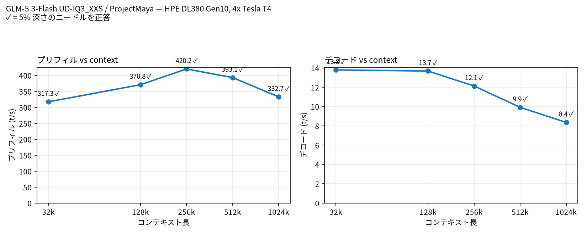

# Tesla T4 4 枚で GLM-5.3-Flash UD-IQ3_XXS を ProjectMaya で 1M コンテキストまで検証

- **作成者**: MG8853
- **作成日**: 2026-10-18

## 概要

HPE ProLiant DL380 Gen10 に Tesla T4 × 4（15 GB / 枚）を載せた構成で、GLM-5.3-Flash の UD-IQ3_XXS（112.1 GiB）を ProjectMaya v1.1.15 で 32k / 128k / 256k / 512k / 1M の各コンテキストで計測しました。各プロンプトの 5% 深さに一意なコード（`BENCH-OF-US-7F3A`）を置き、末尾でその戻り値を問うニードル検索も同時に実行しています。ProjectMaya の MTP（NextN）投機的デコードは有効で、これらの実行では 15 投機位置で 93.3% が採択されました。
32k で prefill 317.3 t/s / decode（11 トークン回答）13.79 t/s、128k で 370.8 / 13.68、256k で 420.2 / 12.13、512k で 393.1 / 9.92、1M で 332.7 / 8.36 t/s でした。ニードルは 1M まで正答しています。
256k の TTFT は約 10.4 分、512k は約 22.2 分、1M は約 52.5 分です。コーディング用途では、256k はバッチ／エージェント向け、512k 以上は長時間バッチ向けの条件です。

## ハードウェア

| 項目 | 内容 |
|------|------|
| コンピュータ / マザーボード | HPE ProLiant DL380 Gen10 |
| GPU | Tesla T4 × 4（VRAM 15,360 MiB / 枚、電力上限 70 W / 枚） |
| GPU 接続 | PCIe 3.0 x16（`nvidia-smi` の current はアイドル時 Gen1 x16、max は Gen3 x16）。NVLink なし。`nvidia-smi topo -m` では GPU0-GPU1 が NODE、GPU2-GPU3 が NODE、この 2 組の間は SYS（NUMA ノードをまたぐ） |
| CPU | Intel Xeon Gold 6254 × 2（18 コア / 36 スレッド × 2。この環境でオンラインなのは 36 論理 CPU） |
| メモリ | 232 GiB |
| 電源 | 不明 |

## ソフトウェア環境

| 項目 | 内容 |
|------|------|
| OS | Ubuntu 26.04.1 LTS / Linux 7.0.14-14-pve |
| GPU ドライバ | 615.71.09（CUDA UMD 13.4） |
| ProjectMaya | v1.1.15（commit a4e1ff0、2026-10-16）、CUDA 13.2 でビルド |
| 比較用 llama.cpp | master 62318cd57（version 0.7.0-dev build 11709）、CUDA 13.2、`CMAKE_CUDA_ARCHITECTURES=75` |

## ベンチマーク

### 条件

| 項目 | 内容 |
|------|------|
| ツール | `maya_depth_bench.py`（ProjectMaya の `GEN` / `DONE` プロトコルを直接使う独自ハーネス） |
| モデル | `unsloth/GLM-5.3-Flash-GGUF` の UD-IQ3_XXS（4 シャード計 120,367,571,840 バイト = 112.1 GiB）。`glm5-next`、46 ブロック、エキスパート 288 / 使用 8、GGUF 上のコンテキスト長 1,048,576 |
| エンジン設定 | ProjectMaya v1.1.15 の `--serve`、`--expert-cache auto`、`--prefill auto`、`--kv-streaming on`、4 GPU（0,1,2,3）、`--layer-split auto`。各コンテキストごとに `--max-context` を変えてエンジンを再起動 |
| プロンプト | リポジトリの README / docs / src / serve / bench のコードと文章を繰り返して構築。5% 深さに `def bench_of_us_secret(): return "BENCH-OF-US-7F3A"` を置き、末尾に「この関数の戻り値を答えよ」という問いを置いた。GLM のチャットテンプレートで包み、greedy、最大 64 トークン。実際の回答は全 ctx で 11 トークン（`finish: stop`）だった |
| ctx | 32768 / 131072 / 262144 / 524288 / 1048576（各段で新しいエンジンと新しいプロンプト。段間のコンテキスト再利用はなし） |
| KV キャッシュ | エンジン管理。KV streaming 有効、各 DSA 層の 32,768 位置を VRAM、残りを pinned RAM に置く |
| 投機的デコード | MTP（NextN）有効。実行ごとのエンジンログで 15 投機位置・93.3% 採択 |
| その他 | テキストのみ（vision なし）、temperature 0、`--prefill auto`（8,192 トークン chunk）、CPU lane 14 threads / GPU |

### 結果

単位は t/s です。prefill 時間は `DONE` の prompt_ms、TTFT の目安です。MTP はエンジンログの `glm spec`（15 speculative positions）の採択率です。decode はニードル回答の生成速度（11 トークン、`finish: stop`）であり、持続生成の decode 性能ではありません。

| depth | prompt tokens | prefill | prefill 時間 | decode（11 tok） | MTP 採択 | ニードル | load |
|----:|------:|------:|------:|------:|------:|:---:|------:|
| 32k | 32,688 | 317.3 | 103.0 s | 13.79 | 93.3% | ✓ | 75.3 s |
| 128k | 130,992 | 370.8 | 353.2 s | 13.68 | 93.3% | ✓ | 75.3 s |
| 256k | 262,064 | 420.2 | 623.7 s | 12.13 | 93.3% | ✓ | 76.1 s |
| 512k | 524,208 | 393.1 | 1,333.6 s | 9.92 | 93.3% | ✓ | 77.8 s |
| 1M | 1,048,496 | 332.7 | 3,151.8 s | 8.36 | 93.3% | ✓ | 80.1 s |

### 所感

- prefill は 32k の 317.3 t/s から 256k の 420.2 t/s まで上がり、512k で 393.1 t/s、1M で 332.7 t/s に下がりました。8,192 トークン chunk のバッチ処理が長いプロンプトで効く一方、512k 以上では KV streaming と attention のコストが増えるためと考えられます。
- 11 トークン回答の生成速度は 32k の 13.79 t/s から 512k の 9.92、1M の 8.36 t/s へ低下します。エンジンログでは、層あたりの VRAM エキスパート slot が 32k の約 130 から 1M の 85〜102 に減り、VRAM ヒット率が 66.1% から 60.1% に、RAM からのエキスパート取得が 15.0 から 24.0 個 / トークンに増えています。1M ではルーティングされたエキスパートの 68% だけが VRAM に載るため、回答生成の低下は避けられません。
- 5% 深さのニードルは 1M まで正答しました。単純な速度だけでなく、100 万トークンの先頭付近のコードを末尾の質問から参照できることを確認しています。
- TTFT は 256k で約 10.4 分、512k で約 22.2 分、1M で約 52.5 分です。256k はエージェント的なバッチ処理に向き、512k 以上はさらに長時間のバッチ向けです。短い回答の生成は 8〜14 t/s で、この条件での回答レイテンシは T4 4 枚としては許容範囲です。持続生成の decode 性能は測っていません。
- コーディング用途の目安: 256k は TTFT 10.4 分・回答生成 12.1 t/s、512k は 22.2 分・9.9 t/s、1M は 52.5 分・8.4 t/s です。256k はエージェントのバッチ処理、1M はリポジトリ全体を一度読ませる長時間ジョブ向けです。
- ProjectMaya は 512k でルーティングされたエキスパートの 76%、1M で 68% を VRAM に置き、残りを RAM から取得しています。ディスク読み出しは 0.00 回 / トークンで、232 GiB の RAM にエキスパートを pin できることが長コンテキスト運用の鍵です。
- 比較用に llama.cpp の `-cmoe`（全エキスパート CPU）は 16k で prefill 37.5 t/s でした。同じペースで 256k を読むと約 2 時間かかる計算になり、ProjectMaya の 10.4 分とは大きな差があります。T4 4 枚で長コンテキストを扱う場合、ProjectMaya の階層型エキスパート配置が実用的です。
- MTP は 93.3% 採択で、回答生成の値は投機的デコード込みです。llama.cpp 側の比較値は投機的デコードなしなので、エンジン間の生成速度を比べる際はこの違いを含めて解釈する必要があります。
- この検証は各コンテキスト 1 本のニードル検索と速度計測であり、コーディング品質そのもの（生成コードの正しさ）は評価していません。

## 添付

- [results.json](attachment/2026-10-18_061111_validating_glm_5.3_flash_ud_iq3_xxs_up_to_1m_context_on_4x_tesla_t4/results.json)（各 ctx の prompt tokens / prefill / decode / needle / MTP 採択）
- [long-context-ja.png](attachment/2026-10-18_061111_validating_glm_5.3_flash_ud_iq3_xxs_up_to_1m_context_on_4x_tesla_t4/long-context-ja.png) / [long-context-en.png](attachment/2026-10-18_061111_validating_glm_5.3_flash_ud_iq3_xxs_up_to_1m_context_on_4x_tesla_t4/long-context-en.png)
- [maya-ud-iq3_xxs-1m.json](attachment/2026-10-18_061111_validating_glm_5.3_flash_ud_iq3_xxs_up_to_1m_context_on_4x_tesla_t4/maya-ud-iq3_xxs-1m.json)（1M 用の設定例。ホームディレクトリは `~` に置換）
- [engine-stats.txt](attachment/2026-10-18_061111_validating_glm_5.3_flash_ud_iq3_xxs_up_to_1m_context_on_4x_tesla_t4/engine-stats.txt)（各 ctx の `glm stat` / `glm spec` / `glm kv` / `glm split` 行。パスは除去）
- [maya_depth_bench.py](attachment/2026-10-18_061111_validating_glm_5.3_flash_ud_iq3_xxs_up_to_1m_context_on_4x_tesla_t4/maya_depth_bench.py)（計測に使った独自ハーネス。ProjectMaya リポジトリ内で実行する前提で、`ROOT` は `~/project-maya` に置換）

