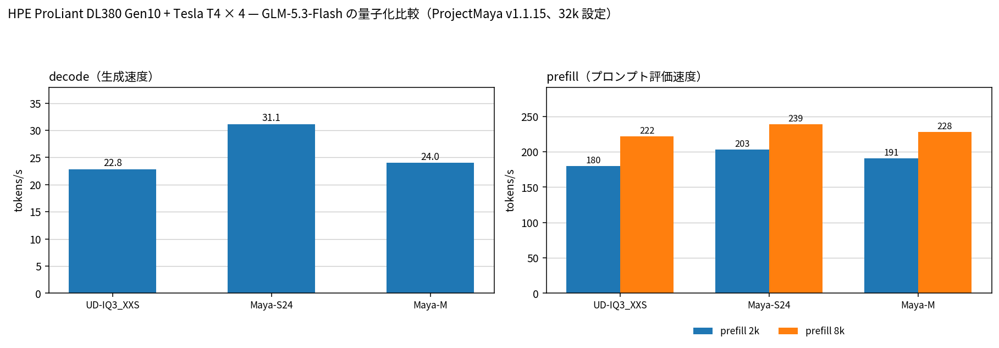

# Tesla T4 4 枚で GLM-5.3-Flash の Maya-S24 / Maya-M / UD-IQ3_XXS を比較

- **作成者**: MG8853
- **作成日**: 2026-10-18

## 概要

HPE ProLiant DL380 Gen10 に Tesla T4 × 4（15 GB / 枚）を載せた構成で、GLM-5.3-Flash の 3 つの量子化を ProjectMaya v1.1.15 で比較しました。UD-IQ3_XXS（Unsloth のコミュニティ量子化、112.1 GiB）、Maya-S24（ProjectMaya の 15〜24 GB カード向け、88.2 GiB）、Maya-M（同・高品質向け、108.0 GiB）です。
32k 設定の標準ベンチでは、Maya-S24 が decode 31.1 t/s で最も速く、UD-IQ3_XXS の 22.8 t/s に対して +36%、Maya-M の 24.0 t/s に対して +30% でした。prefill も S24 が 203 / 239 t/s（2k / 8k）で最速です。256k では S24 が prefill 439.1 t/s / decode 12.22 t/s、UD が 420.2 / 12.13 t/s で、どちらもニードル検索に正答しました。1M は UD のみ検証済み（332.7 / 8.36 t/s、正答）です。
T4 15 GB × 4 でコーディング用途に使うなら、32k〜256k は **Maya-S24**、1M が必要なら検証済みの **UD-IQ3_XXS**、品質優先なら **Maya-M** が候補です。

## ハードウェア

| 項目 | 内容 |
|------|------|
| コンピュータ / マザーボード | HPE ProLiant DL380 Gen10 |
| GPU | Tesla T4 × 4（VRAM 15,360 MiB / 枚、電力上限 70 W / 枚） |
| GPU 接続 | PCIe 3.0 x16（`nvidia-smi` の current はアイドル時 Gen1 x16、max は Gen3 x16）。NVLink なし。`nvidia-smi topo -m` では GPU0-GPU1 が NODE、GPU2-GPU3 が NODE、この 2 組の間は SYS（NUMA ノードをまたぐ） |
| CPU | Intel Xeon Gold 6254 × 2（18 コア / 36 スレッド × 2。この環境でオンラインなのは 36 論理 CPU） |
| メモリ | 232 GiB |
| 電源 | 不明 |

## ソフトウェア環境

| 項目 | 内容 |
|------|------|
| OS | Ubuntu 26.04.1 LTS / Linux 7.0.14-14-pve |
| GPU ドライバ | 615.71.09（CUDA UMD 13.4） |
| ProjectMaya | v1.1.15（commit a4e1ff0、2026-10-16）、CUDA 13.2 でビルド。llama.cpp pinned 3cf03257f2 |

## 量子化

| 量子化 | サイズ | 構成 | 公表されている精度（FP8 比） |
|------|------:|------|------|
| UD-IQ3_XXS | 112.1 GiB（120.4 GB） | Unsloth のコミュニティ量子化。ルーティングエキスパートは IQ3_XXS 系、attention は Q6_K 系 | 不明（FP8 比の公表値なし） |
| Maya-S24 | 88.2 GiB（94.7 GB） | ProjectMaya の 15〜24 GB カード向け。ルーティングエキスパートは IQ2_XXS / IQ2_S、attention は Q4_K（S の Q6_K から軽量化） | 97.7% |
| Maya-M | 108.0 GiB（116.0 GB） | ProjectMaya の中間。ルーティングエキスパートは IQ2_S / IQ3_XXS、attention は Q6_K | 97.9% |

- 精度は ProjectMaya のモデルカード（`peasantsmith/GLM-5.3-Flash-Maya-GGUF`）に公表されている値で、**今回の計測では品質を評価していません**。UD-IQ3_XXS はコミュニティ量子化で、FP8 比の公表値がありません。
- 参考: Maya-S は 97.9%、Maya-L は 99.2%（モデルカード）。今回は S24 と M を計測しました。

## ベンチマーク

### 条件

| 項目 | 内容 |
|------|------|
| ツール（32k） | `./maya.sh --bench`（ProjectMaya 標準ベンチ） |
| ツール（256k / 1M） | `maya_depth_bench.py`（`GEN` / `DONE` を直接使う独自ハーネス。5% 深さのニードル検索付き） |
| モデル | 上記 3 量子化。いずれも同じ GLM-5.3-Flash（`glm5-next`、46 ブロック、エキスパート 288 / 使用 8、コンテキスト長 1,048,576） |
| 測定モード（32k） | 4 GPU（0,1,2,3）の layer 分割、`--expert-cache auto`、`--prefill auto`、`--kv-streaming on`。3 問 × 256 トークン（greedy、thinking off）、prefill は 2048 / 8192 トークン |
| 測定モード（256k / 1M） | 同じエンジン設定で `--max-context` を変更。5% 深さに `BENCH-OF-US-7F3A` を置き、末尾で戻り値を問う。greedy、最大 64 トークン |
| 投機的デコード | MTP（NextN）有効。添付の標準ベンチログには採択率の行がないため、`the draft layer` とプール前使用量の `other (context, MTP, scratch, prompt path)` 行で有効を確認 |
| その他 | テキストのみ（vision なし）、RAM 232 GiB、SSD からのエキスパート読み出しは全量子化で 0.00 回 / トークン |

### 結果（32k 設定の標準ベンチ）

| 量子化 | decode | prefill 2k | prefill 8k | VRAM ヒット | RAM に pin |
|------|------:|------:|------:|------:|------:|
| UD-IQ3_XXS | 22.8 t/s | 180 t/s | 222 t/s | 74% | 69.8 GB |
| Maya-S24 | **31.1 t/s** | **203 t/s** | **239 t/s** | 82% | 44.8 GB |
| Maya-M | 24.0 t/s | 191 t/s | 228 t/s | 76% | 65.4 GB |

「RAM に pin」は 4 GPU の RAM tier の合計です。VRAM ヒットは、3 問の decode 時に `glm stat` が記録した、ルーティングされたエキスパートのうち VRAM から供給できた割合の平均です。S24 は 81.03 / 83.33 / 80.75% の平均 81.7% を 82% と表示しています。モデルロード時間と MTP の採択率は、添付の標準ベンチログに該当行がないため表から外しました。配置計画の比率は各ログの `glm split auto:` 行に `93% of the routed experts in VRAM`（S24）/ `82%`（UD）/ `84%`（M）と記録されています。

### 結果（256k / 1M、ニードル検証）

| 量子化 | ctx | prefill | decode | TTFT | ニードル |
|------|----:|------:|------:|------:|:---:|
| UD-IQ3_XXS | 256k | 420.2 t/s | 12.13 t/s | 10.4 分 | ✓ |
| Maya-S24 | 256k | 439.1 t/s | 12.22 t/s | 9.9 分 | ✓ |
| Maya-M | 256k | 未計測 | 未計測 | 未計測 | 未計測 |
| UD-IQ3_XXS | 1M | 332.7 t/s | 8.36 t/s | 52.5 分 | ✓ |
| Maya-S24 | 1M | 未計測 | 未計測 | 未計測 | 未計測 |
| Maya-M | 1M | 未計測 | 未計測 | 未計測 | 未計測 |

UD の 256k / 1M は [別レポート](2026-10-18_061111_validating_glm_5.3_flash_ud_iq3_xxs_up_to_1m_context_on_4x_tesla_t4.md) の値です。S24 の 256k は今回の追加計測です。

### 所感

- **32k では Maya-S24 が圧勝**しました。decode 31.1 t/s は UD-IQ3_XXS の 22.8 t/s に対して +36%、Maya-M の 24.0 t/s に対して +30% です。S24 は attention を Q4_K に軽量化したぶん、VRAM のエキスパートプールを広く取れます。エンジンの配置計画ではルーティングされたエキスパートの 93% を VRAM に置き（UD は 82%、M は 84%）、実測の VRAM ヒットは 82%（UD は 74%、M は 76%）、RAM からの取得は 5.3 個 / トークン（UD は 8.8〜10.6 個）で済んでいます。RAM tier も 44.8 GB と UD の 69.8 GB より少なく、同じ 232 GiB のマシンでより長いコンテキストに余力を残せます。
- **Maya-M は UD よりわずかに速い程度**です。decode 24.0 対 22.8（+5%）、prefill 191 / 228 対 180 / 222（+6% / +3%）で、S24 より 23% 遅い結果でした。公表精度は 97.9% で S24 の 97.7% よりわずかに高いため、速度より品質を優先する場合の選択肢になります。ただし今回の計測は速度とニードル検索のみで、品質差は確認していません。
- **256k では S24 と UD の差が縮まります**。prefill 439.1 対 420.2（+4.5%）、decode 12.22 対 12.13（+0.7%）で、ほぼ同等です。長いコンテキストでは KV streaming と attention のコストが支配的になり、32k でのエキスパート配置の優位が薄れるためと考えられます。それでも S24 は RAM tier が少なく、TTFT も 9.9 分と UD の 10.4 分より短いです。
- **1M は UD-IQ3_XXS のみ検証済み**です。prefill 332.7 t/s / decode 8.36 t/s、5% 深さのニードルに正答しました。S24 と M の 1M は未計測です。1M を必須にするなら、現時点で実証済みなのは UD です。S24 は 256k まで正答しており、1M でも動く可能性は高いですが、未確認です。
- MTP は全量子化で有効です（採択率は添付の標準ベンチログに記録されていません）。decode 値は投機的デコード込みです。
- **T4 15 GB × 4 でのおすすめ**:
  - 32k〜256k のコーディング／エージェント用途: **Maya-S24**（最速、RAM 消費も少ない）
  - 1M コンテキストが必要: **UD-IQ3_XXS**（1M 検証済み。速度は S24 よりわずかに劣る）
  - 品質優先: **Maya-M**（公表 97.9%。S24 より 23% 遅い）。さらに品質を求めるなら Maya-L（99.2%、今回は未計測）
- この比較は速度とニードル検索の結果です。生成コードの正しさや長文での推論品質は評価していません。精度の数値はモデルカードの公表値で、UD-IQ3_XXS には FP8 比の公表値がありません。

## 添付

- 標準ベンチ（32k）
  - [maya-bench-ud-iq3_xxs.txt](attachment/2026-10-18_070335_comparing_maya_s24_maya_m_and_ud_iq3_xxs_of_glm_5.3_flash_on_4x_tesla_t4/maya-bench-ud-iq3_xxs.txt)
  - [maya-bench-s24.txt](attachment/2026-10-18_070335_comparing_maya_s24_maya_m_and_ud_iq3_xxs_of_glm_5.3_flash_on_4x_tesla_t4/maya-bench-s24.txt)
  - [maya-bench-m.txt](attachment/2026-10-18_070335_comparing_maya_s24_maya_m_and_ud_iq3_xxs_of_glm_5.3_flash_on_4x_tesla_t4/maya-bench-m.txt)
- 256k / 1M
  - [s24-256k-results.json](attachment/2026-10-18_070335_comparing_maya_s24_maya_m_and_ud_iq3_xxs_of_glm_5.3_flash_on_4x_tesla_t4/s24-256k-results.json) / [s24-256k-engine-stats.txt](attachment/2026-10-18_070335_comparing_maya_s24_maya_m_and_ud_iq3_xxs_of_glm_5.3_flash_on_4x_tesla_t4/s24-256k-engine-stats.txt)
  - [ud-256k-1m-results.json](attachment/2026-10-18_070335_comparing_maya_s24_maya_m_and_ud_iq3_xxs_of_glm_5.3_flash_on_4x_tesla_t4/ud-256k-1m-results.json)
- 図とデータ
  - [quant-compare-ja.png](attachment/2026-10-18_070335_comparing_maya_s24_maya_m_and_ud_iq3_xxs_of_glm_5.3_flash_on_4x_tesla_t4/quant-compare-ja.png) / [quant-compare-en.png](attachment/2026-10-18_070335_comparing_maya_s24_maya_m_and_ud_iq3_xxs_of_glm_5.3_flash_on_4x_tesla_t4/quant-compare-en.png)
  - [quant-data.json](attachment/2026-10-18_070335_comparing_maya_s24_maya_m_and_ud_iq3_xxs_of_glm_5.3_flash_on_4x_tesla_t4/quant-data.json)
- 設定
  - [maya-maya-s24.json](attachment/2026-10-18_070335_comparing_maya_s24_maya_m_and_ud_iq3_xxs_of_glm_5.3_flash_on_4x_tesla_t4/maya-maya-s24.json) / [maya-maya-m.json](attachment/2026-10-18_070335_comparing_maya_s24_maya_m_and_ud_iq3_xxs_of_glm_5.3_flash_on_4x_tesla_t4/maya-maya-m.json)（ホームディレクトリは `~` に置換）

