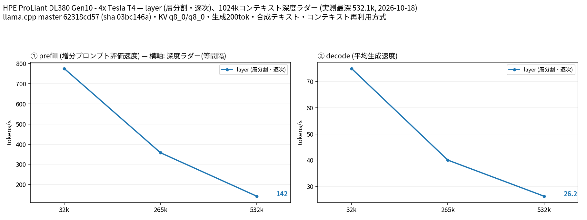
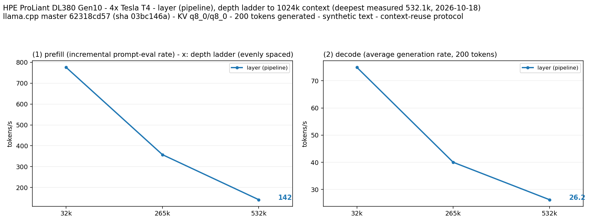

# Tesla T4 4 枚で Nemotron 3.5 Lightning 30B A3B CRACK を 265k/532k（公称 256k/512k）で検証し 1M のロードを確認

- **作成者**: MG8853
- **作成日**: 2026-10-18

## 概要

HPE ProLiant DL380 Gen10 + Tesla T4 × 4（15 GB / 枚）で、[dealignai/Nemotron-3.5-Lightning-30B-A3B-CRACK-GGUF](https://huggingface.co/dealignai/Nemotron-3.5-Lightning-30B-A3B-CRACK-GGUF) の Q4_K_M（25.4 GB）を層分割・KV q8_0・純正 MTP（n-max 2）で 32k / 265k / 532k まで計測し、1M はコンテキストのロードと短い生成のみ確認しました。深さは実測の effective_depth で表記し、公称の 256k / 512k とはプロンプトのトークン数が異なります。`nemotron_h_moe` は tensor 分割に未対応のため、層分割のみです。

265k（公称 256k）で prefill 357.5 t/s / decode 40.0 t/s、532k（公称 512k）で prefill 141.7 t/s / decode 26.2 t/s でした。1M はネイティブでロードでき、1M の速度計測はハーネスの 7200 秒タイムアウトで完了しなかったものの、1M コンテキストのロードと短い生成（31.3 t/s）は別途確認しました。VRAM は 1M で最も大きい GPU が 14.2 GiB と、T4 の 15 GiB に対して余裕が小さい状態です。

コーディング評価（HumanEval 164 問、chat 形式、temperature 0）は **143/164 = 87.2%** でした。同じハーネス・同じビルドで測った Ornith-1.5 35B A3B の 147/164 = 89.6% より 2.4 ポイント低い結果です。

## ハードウェア

| 項目 | 内容 |
|------|------|
| コンピュータ / マザーボード | HPE ProLiant DL380 Gen10 |
| GPU | Tesla T4 × 4（VRAM 15,360 MiB / 枚、電力上限 70 W / 枚） |
| GPU 接続 | PCIe 3.0 x16（`nvidia-smi` の current はアイドル時 Gen1 x16、max は Gen3 x16）。NVLink なし。`nvidia-smi topo -m` では GPU0-GPU1 が NODE、GPU2-GPU3 が NODE、この 2 組の間は SYS（NUMA ノードをまたぐ） |
| CPU | Intel Xeon Gold 6254 × 2（18 コア / 36 スレッド × 2。この環境でオンラインなのは 36 論理 CPU） |
| メモリ | 232 GiB |
| 電源 | 不明 |

## ソフトウェア環境

| 項目 | 内容 |
|------|------|
| OS | Ubuntu 26.04.1 LTS / Linux 7.0.14-14-pve |
| GPU ドライバ | 615.71.09（CUDA UMD 13.4） |
| llama.cpp | 0.7.0-dev（build 11709、commit `62318cd57`）、CUDA バックエンド。NCCL 2.30.4 |
| ベンチマーク | llama-split-bench 7af72d4 |

## ベンチマーク

### 条件

| 項目 | 内容 |
|------|------|
| ツール | llama-split-bench 7af72d4 |
| モデル | `Nemotron-CRACK-Q4_K_M.gguf`（25,430,739,648 バイト、ベースは `nvidia/NVIDIA-Nemotron-3.5-Lightning-30B-A3B`、52 層の Mamba-2 / MoE / attention ハイブリッド、128 エキスパート、約 3B アクティブ） |
| 測定モード | layer（CUDA0〜CUDA3 の 4 枚）。`nemotron_h_moe` は `--split-mode tensor` に未対応のため tensor は未実施 |
| ctx / stages | 1048576 / 0,32000,258000,524000,1040000（YaRN なし。ネイティブで 1M を確保） |
| KV キャッシュ | q8_0 / q8_0 |
| 投機的デコード | `--spec-type draft-mtp --spec-draft-n-max 2`（モデル内蔵の nextn 1 層） |
| その他 | `-fa on`、`-ngl all`、`-t 16`、`--parallel 1`、`--jinja`、`--cache-ram 8192 --cache-idle-slots --cache-reuse 256`、生成 200 トークン / 段、PORT 18081、`LAUNCH_PREFIX` なし |

### 結果

単位は t/s です。ラダー初段（11 トークン）の prefill は計測上のアーティファクトなので表と図から除外しています。pp0（新規プロンプト）は取得していないため depth 0 の行はありません。

32k / 265k / 532k は実測の effective_depth（32,093 / 265,242 / 532,129 トークン）で、公称の 32k / 256k / 512k よりプロンプトが長くなっています。

| depth | prefill | decode | MTP 採択率 |
|------:|------:|------:|------:|
| 32k | 775.6 | 74.9 | 0.921 |
| 265k | 357.5 | 40.0 | 0.956 |
| 532k | 141.7 | 26.2 | 0.901 |
| 1M | 未取得 | 未取得 | 未取得 |

1M のラダーは進捗 0.72・経過 7,200 秒でタイムアウトしました。532k の prefill 141.7 t/s から単純に外挿すると 1M の prefill には約 2〜3 時間かかり、ハーネスの 1 リクエスト 7,200 秒の上限を超えます。1M のロード自体は成功しており、VRAM は上記のとおりです。

VRAM は 1M コンテキスト確保時（`1m-load-check.txt`）で CUDA0 / CUDA1 / CUDA2 / CUDA3 の順に 12,459 / 11,329 / 12,473 / 14,517 MiB でした。T4 の 15,360 MiB に対する余裕は約 0.8 GiB です。ラダーが到達した 532k 段の実行中は `results-layer.json` の `gpu_after` で 12,487 / 11,357 / 12,501 / 14,549 MiB でしたが、これは 1M のロード時の値ではありません。

### コーディング評価（HumanEval）

HumanEval の全 164 問を、chat 形式（system で「関数を完成させ、コードブロックのみ返す」と指示）、temperature 0、max_tokens 768、`enable_thinking: false` で解かせ、公式のテストコードを subprocess（10 秒タイムアウト）で実行しました。プロンプト形式は公式の completion 形式ではなく chat 形式なので、公式スコアと直接比較する場合は注意してください。

| 指標 | 結果 |
|------|------|
| pass@1 | **143/164 = 87.2%** |
| 1 問あたりの平均時間 | 3.87 秒 |
| 参考: Ornith-1.5 35B A3B（同一ハーネス、PR #65） | 147/164 = 89.6% |

同一ハーネス・同一ビルドでの横断比較（HumanEval 164 問、chat 形式、temperature 0）:

| モデル | pass@1 | 出典 |
|--------|------:|------|
| Qwen3.8 27B Uncensored Q5_K_M | 156/164 = 95.1% | PR #64 |
| 参考: Ornith-1.5 35B A3B（ベース） | 147/164 = 89.6% | PR #65 |
| Ornith 1.5 35B A3B Uncensored Q4_K_M | 145/164 = 88.4% | PR #63 |
| Nemotron 3.5 Lightning 30B A3B CRACK Q4_K_M | 143/164 = 87.2% | 本レポート |

## 所感

- 265k（公称 256k）で prefill 357.5 / decode 40.0 t/s、532k（公称 512k）で 141.7 / 26.2 t/s です。深さが約 2 倍になると prefill は約 60%、decode は約 35% 低下します。
- MTP の採択率は 0.90〜0.96 と高く、長コンテキストでも投機デコードが効いています。
- 1M はロードできますが、GPU3 の VRAM が 14,517 MiB と上限に近く、フルの 1M プロンプトを流すと prefill に 2 時間以上かかると外挿されます。常用するなら 532k（公称 512k）以下が現実的です。
- HumanEval は 143/164 = 87.2% で、同ハーネスの Ornith-1.5（147/164 = 89.6%）より 2.4 ポイント低い結果です。CRACK の MMLU 低下（78.3% → 74.2%、README 記載）と整合する方向ですが、HumanEval の差がモデル由来かどうかは 1 回の測定では断定できません。
- このモデルは reasoning（thinking）が既定で ON です。HumanEval では `enable_thinking: false` を指定しましたが、テンプレートが対応していない場合は思考が入り、1 問あたりの時間が増えます（平均 3.87 秒）。

## 添付

- [split-bench-ja.png](attachment/2026-10-18_170112_validating_nemotron_3.5_lightning_30b_a3b_crack_at_256k_512k_1m_on_4x_tesla_t4/split-bench-ja.png) / [split-bench-en.png](attachment/2026-10-18_170112_validating_nemotron_3.5_lightning_30b_a3b_crack_at_256k_512k_1m_on_4x_tesla_t4/split-bench-en.png)（results-layer.json の 32k / 265k / 532k からハーネス標準の `plot_bench.py` で作成。1M ステージ中断のため 1M は含まない）
- [results-layer.json](attachment/2026-10-18_170112_validating_nemotron_3.5_lightning_30b_a3b_crack_at_256k_512k_1m_on_4x_tesla_t4/results-layer.json)
- [run-info.json](attachment/2026-10-18_170112_validating_nemotron_3.5_lightning_30b_a3b_crack_at_256k_512k_1m_on_4x_tesla_t4/run-info.json)（1M 段のタイムアウトでハーネスが run-info を書き出す前に終了したため、argv・results・ログと同一バイナリの情報から再構成。`note` に明記）
- [argv-layer.txt](attachment/2026-10-18_170112_validating_nemotron_3.5_lightning_30b_a3b_crack_at_256k_512k_1m_on_4x_tesla_t4/argv-layer.txt)
- [nemotron-crack-humanEval.json](attachment/2026-10-18_170112_validating_nemotron_3.5_lightning_30b_a3b_crack_at_256k_512k_1m_on_4x_tesla_t4/nemotron-crack-humanEval.json)
- [1m-load-check.txt](attachment/2026-10-18_170112_validating_nemotron_3.5_lightning_30b_a3b_crack_at_256k_512k_1m_on_4x_tesla_t4/1m-load-check.txt)
