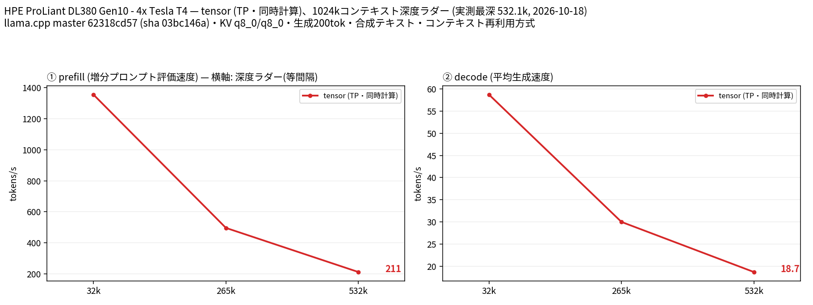
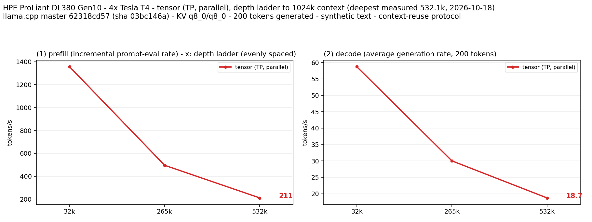

# Tesla T4 4 枚で Ornith 1.5 35B A3B Uncensored を 265k/532k（公称 256k/512k）で計測し 1M のロードを確認

- **作成者**: MG8853
- **作成日**: 2026-10-18

## 概要

HPE ProLiant DL380 Gen10 + Tesla T4 × 4（15 GB / 枚）で、[0xKitkat/Ornith-1.5-35B-A3B-Uncensored-GGUF](https://huggingface.co/0xKitkat/Ornith-1.5-35B-A3B-Uncensored-GGUF) の Q4_K_M（20.22 GiB）を tensor 分割・KV q8_0・純正 MTP（n-max 2）で 32k / 265k / 532k まで計測し、1M はコンテキストの確保と短い生成のみ確認しました。深さは実測の effective_depth で表記し、公称の 256k / 512k とはプロンプトのトークン数が異なります。ネイティブの 262,144 を超える範囲は YaRN factor 4.0 で拡張しています。

265k（公称 256k）で prefill 495.7 t/s / decode 30.0 t/s、532k（公称 512k）で 211.1 / 18.7 t/s でした。1M は VRAM 12.0〜13.3 GiB / 枚でロードできましたが、prefill/decode は未取得です（時間の都合で打ち切り）。

コーディング評価（HumanEval 164 問、chat 形式、temperature 0）は **145/164 = 88.4%** でした。

## ハードウェア

| 項目 | 内容 |
|------|------|
| コンピュータ / マザーボード | HPE ProLiant DL380 Gen10 |
| GPU | Tesla T4 × 4（VRAM 15,360 MiB / 枚、電力上限 70 W / 枚） |
| GPU 接続 | PCIe 3.0 x16（`nvidia-smi` の current はアイドル時 Gen1 x16、max は Gen3 x16）。NVLink なし。`nvidia-smi topo -m` では GPU0-GPU1 が NODE、GPU2-GPU3 が NODE、この 2 組の間は SYS（NUMA ノードをまたぐ） |
| CPU | Intel Xeon Gold 6254 × 2（18 コア / 36 スレッド × 2。この環境でオンラインなのは 36 論理 CPU） |
| メモリ | 232 GiB |
| 電源 | 不明 |

## ソフトウェア環境

| 項目 | 内容 |
|------|------|
| OS | Ubuntu 26.04.1 LTS / Linux 7.0.14-14-pve |
| GPU ドライバ | 615.71.09（CUDA UMD 13.4） |
| llama.cpp | 0.7.0-dev（build 11709、commit `62318cd57`）、CUDA バックエンド。NCCL 2.30.4 |
| ベンチマーク | llama-split-bench 7af72d4 |

## ベンチマーク

### 条件

| 項目 | 内容 |
|------|------|
| ツール | llama-split-bench 7af72d4 |
| モデル | `Ornith-1.5-35B-Uncensored-Q4_K_M.gguf`（21,713,463,264 バイト、ベースは `ornith-ai/Ornith-1.5-35B-A3B`、Qwen3.6-abliterated のタスクベクトルを適用。262K コンテキスト、純正 MTP 1 層、vision tower は未使用） |
| 測定モード | tensor（CUDA0〜CUDA3 の 4 枚、TP=4） |
| ctx / stages | 1048576 / 0,32000,258000,524000,1040000（YaRN factor 4.0、`--yarn-orig-ctx 262144`） |
| KV キャッシュ | q8_0 / q8_0 |
| 投機的デコード | `--spec-type draft-mtp --spec-draft-n-max 2`（モデル内蔵の nextn 1 層） |
| その他 | `-fa on`、`-ngl all`、`-t 16`、`--parallel 1`、`--jinja`、`--cache-ram 8192 --cache-idle-slots --cache-reuse 256`、生成 200 トークン / 段、PORT 18081、`LAUNCH_PREFIX` なし |

### 結果

単位は t/s です。ラダー初段（11 トークン）の prefill は計測上のアーティファクトなので表と図から除外しています。pp0（新規プロンプト）は取得していないため depth 0 の行はありません。

32k / 265k / 532k は実測の effective_depth（32,093 / 265,242 / 532,129 トークン）です。

| depth | prefill | decode | MTP 採択率 |
|------:|------:|------:|------:|
| 32k | 1355.6 | 58.7 | 0.478 |
| 265k | 495.7 | 30.0 | 0.518 |
| 532k | 211.1 | 18.7 | 0.518 |
| 1M | 未取得 | 未取得 | 未取得 |

265k 段の実効 depth は 265,242 で、モデルのネイティブ上限 262,144 を 3,098 トークン超えています（YaRN factor 4.0 適用）。

### コーディング評価（HumanEval）

HumanEval の全 164 問を、chat 形式（system で「関数を完成させ、コードブロックのみ返す」と指示）、temperature 0、max_tokens 768、`enable_thinking: false` で解かせ、公式のテストコードを subprocess（10 秒タイムアウト）で実行しました。プロンプト形式は公式の completion 形式ではなく chat 形式なので、公式スコアと直接比較する場合は注意してください。

| 指標 | 結果 |
|------|------|
| pass@1 | **145/164 = 88.4%** |
| 1 問あたりの平均時間 | 2.96 秒 |
| 参考: ベース Ornith-1.5 35B A3B（同一ハーネス） | 147/164 = 89.6% |

同一ハーネス・同一ビルドでの横断比較（HumanEval 164 問、chat 形式、temperature 0）:

| モデル | pass@1 | 出典 |
|--------|------:|------|
| Qwen3.8 27B Uncensored Q5_K_M | 156/164 = 95.1% | PR #64 |
| 参考: Ornith-1.5 35B A3B（ベース） | 147/164 = 89.6% | PR #65 |
| Ornith 1.5 35B A3B Uncensored Q4_K_M | 145/164 = 88.4% | 本レポート |
| Nemotron 3.5 Lightning 30B A3B CRACK Q4_K_M | 143/164 = 87.2% | PR #62 |

## 所感

- YaRN factor 4.0 を全ステージに適用しているため、32k（ネイティブ上限内）でも 265k（ネイティブ上限を 3,098 トークン超過）でも、ベース Ornith の測定（YaRN なし）とは条件が異なります。切り分けのため、ベース Ornith に同じ YaRN 4.0 を適用した対照実験を 32k で行いました。
  - ベース Ornith、YaRN なし: 32k で prefill 1082.2 / decode 89.5 t/s、採択率 0.906（`reference-stock-mtp-262k/`、生成 1,000 トークン）
  - ベース Ornith、YaRN 4.0: 32k で prefill 1140.1 / decode 89.0 t/s、採択率 0.857（生成 675 トークン。生成上限は 1,000 だが ctx 32,768 に達して打ち切り）
  - Ornith Uncensored、YaRN 4.0: 32k で prefill 1355.6 / decode 58.7 t/s、採択率 0.478（生成 200 トークン）
- 3 群は生成トークン数が揃っていない（ベースは 1,000、YaRN 4.0 の対照は 675、uncensored は 200）ため、採択率の低下（0.906 → 0.478）を YaRN と abliteration に定量的に分離することはできません。低下の大半は uncensored の重み（abliteration）に由来する可能性がありますが、これは仮説です。MTP ヘッド自体はコピーされていても、ターゲットの隠れ状態が変わればドラフトの当たりが悪くなる可能性があります（未検証）。decode は 32k で 89.0 → 58.7 t/s（-34%）ですが、こちらも生成長の違いを含みます。
- 265k（公称 256k）で prefill 495.7 / decode 30.0 t/s、532k（公称 512k）で 211.1 / 18.7 t/s です。1M は VRAM 12.0〜13.3 GiB / 枚でロードでき、短い生成は 22.6 t/s でしたが、1M 深さの prefill/decode は時間の都合で未取得です（ベース Ornith の 514k では prefill 296.2 / decode 24.5 t/s）。
- HumanEval は 145/164 = 88.4% で、ベース Ornith-1.5 の 147/164 = 89.6% とほぼ同等です。abliteration によるコーディング能力の低下は、この 164 問では 2 問（1.2 ポイント）にとどまりました。一方、この条件では投機デコードの採択率が低く、速度目的で uncensored 版を選ぶ利点はありません（YaRN と生成長の違いを含むため、速度差の要因は分離できません）。

## 添付

- [split-bench-ja.png](attachment/2026-10-18_170305_validating_ornith_1.5_35b_a3b_uncensored_at_256k_512k_1m_on_4x_tesla_t4/split-bench-ja.png) / [split-bench-en.png](attachment/2026-10-18_170305_validating_ornith_1.5_35b_a3b_uncensored_at_256k_512k_1m_on_4x_tesla_t4/split-bench-en.png)（results-tensor.json の 32k / 265k / 532k からハーネス標準の `plot_bench.py` で作成。1M ステージ中断のため 1M は含まない）
- [results-tensor.json](attachment/2026-10-18_170305_validating_ornith_1.5_35b_a3b_uncensored_at_256k_512k_1m_on_4x_tesla_t4/results-tensor.json)
- [run-info.json](attachment/2026-10-18_170305_validating_ornith_1.5_35b_a3b_uncensored_at_256k_512k_1m_on_4x_tesla_t4/run-info.json)（1M 段を手動停止して実行を終えたため、ハーネスが run-info を書き出す前に終了。argv・results・ログと同一バイナリの情報から再構成し、`note` に明記）
- [argv-tensor.txt](attachment/2026-10-18_170305_validating_ornith_1.5_35b_a3b_uncensored_at_256k_512k_1m_on_4x_tesla_t4/argv-tensor.txt)
- [ornith-unc-humanEval.json](attachment/2026-10-18_170305_validating_ornith_1.5_35b_a3b_uncensored_at_256k_512k_1m_on_4x_tesla_t4/ornith-unc-humanEval.json)
- [1m-load-check.txt](attachment/2026-10-18_170305_validating_ornith_1.5_35b_a3b_uncensored_at_256k_512k_1m_on_4x_tesla_t4/1m-load-check.txt)
- 対照実験（ベース Ornith、YaRN なし、32k）: [results-tensor.json](attachment/2026-10-18_170305_validating_ornith_1.5_35b_a3b_uncensored_at_256k_512k_1m_on_4x_tesla_t4/reference-stock-mtp-262k/results-tensor.json) / [run-info.json](attachment/2026-10-18_170305_validating_ornith_1.5_35b_a3b_uncensored_at_256k_512k_1m_on_4x_tesla_t4/reference-stock-mtp-262k/run-info.json) / [argv-tensor.txt](attachment/2026-10-18_170305_validating_ornith_1.5_35b_a3b_uncensored_at_256k_512k_1m_on_4x_tesla_t4/reference-stock-mtp-262k/argv-tensor.txt)
- 対照実験（ベース Ornith + YaRN 4.0、32k）: [split-bench-ja.png](attachment/2026-10-18_170305_validating_ornith_1.5_35b_a3b_uncensored_at_256k_512k_1m_on_4x_tesla_t4/control-base-yarn4-32k/split-bench-ja.png) / [results-tensor.json](attachment/2026-10-18_170305_validating_ornith_1.5_35b_a3b_uncensored_at_256k_512k_1m_on_4x_tesla_t4/control-base-yarn4-32k/results-tensor.json) / [results-real.json](attachment/2026-10-18_170305_validating_ornith_1.5_35b_a3b_uncensored_at_256k_512k_1m_on_4x_tesla_t4/control-base-yarn4-32k/results-real.json)
