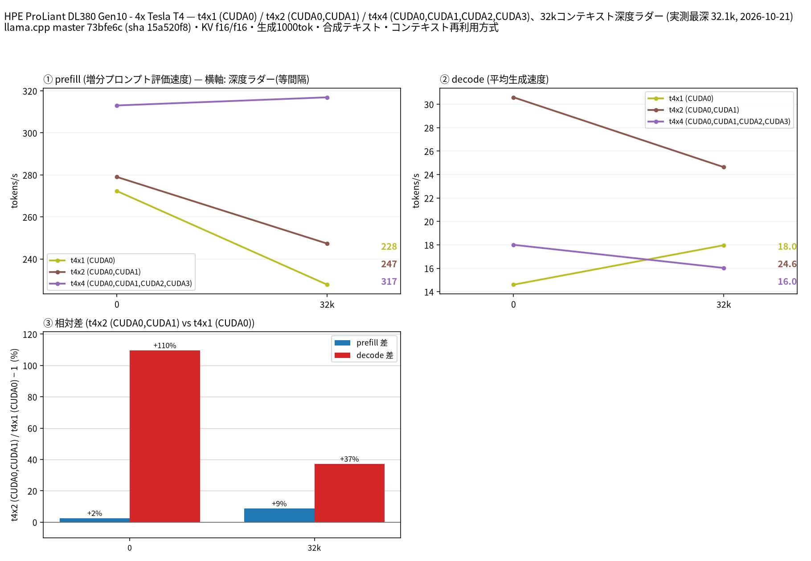

# Tesla T4 4 枚で Ternary Bonsai 2 27B（三値 2bit）を 256k コンテキストまで計測

- **作成者**: MG8853
- **作成日**: 2026-10-21

## 概要

HPE ProLiant DL380 Gen10 + Tesla T4 × 4（15 GB / 枚、70 W 上限）で、[PrismML の Ternary Bonsai 2 27B](https://huggingface.co/prism-ml/Ternary-Bonsai-2-27B-gguf)（Qwen3.8-27B を三値 {-1, 0, +1} に量子化した 27.36B モデル、Apache 2.0）をネイティブ上限の 262,144 トークンまで計測しました。推論には専用フォーク [PrismML-Eng/llama.cpp](https://github.com/PrismML-Eng/llama.cpp)（`prism-b10787-73bfe6c`）を SM75 向けに自前ビルドして使っています。

262k での decode は **PQ2_0（2.13 bpw、7.21 GB）が 6.33 t/s、PTQ1_0（1.75 bpw、5.95 GB）が 8.29 t/s** で、PTQ1_0 が全深度で 1.3〜1.7 倍速いという結果でした。prefill は両者ほぼ同等（258k で 90.9 / 90.4 t/s）です。

GPU 枚数を増やしても速くはならず、**layer 分割では T4 2 枚が最速**でした（32k の decode が 1 枚 17.97、2 枚 24.63、4 枚 16.03 t/s）。これは 4 枚構成が NUMA ノードをまたぐためで、T4 4 枚を 1 モデルに集中させるより 2 枚ずつに分けた方が有利です。

さらにコミュニティ製の MTP ヘッド入り PTQ1_0（`Ternary-Bonsai-2-27B-PTQ1_0-mtp.gguf`、7.01 GB）を 2 枚 + `--spec-draft-n-max 2` で動かすと、**32k で decode 48.95 t/s（採択率 0.993）** と約 2 倍に伸びました。ただし 262k を 2 枚で確保すると KV と計算バッファで OOM するため、256k は 4 枚で計測しています（後述）。

## ハードウェア

| 項目 | 内容 |
|------|------|
| コンピュータ / マザーボード | HPE ProLiant DL380 Gen10 |
| GPU | Tesla T4 × 4（VRAM 15,360 MiB / 枚、電力上限 70 W / 枚） |
| GPU 接続 | PCIe 3.0 x16（`nvidia-smi` の current はアイドル時 Gen1 x16）。NVLink なし。`nvidia-smi topo -m` では GPU0-GPU1 が NODE、GPU2-GPU3 が NODE、この 2 組の間は SYS（NUMA ノードをまたぐ） |
| CPU | Intel Xeon Gold 6254 × 2（18 コア / 36 スレッド × 2、オンライン 72 論理 CPU） |
| メモリ | 232 GiB |
| 電源 | 不明 |

## ソフトウェア環境

| 項目 | 内容 |
|------|------|
| OS | Ubuntu 26.04.1 LTS / Linux 7.0.14-14-pve |
| GPU ドライバ | 615.71.09（CUDA 13.2 の `nvcc` でビルド） |
| llama.cpp | PrismML-Eng/llama.cpp `prism` ブランチ、タグ `prism-b10787-73bfe6c`（commit `73bfe6c`、`version: 0.2.0-dev`）。`-DGGML_CUDA=ON -DCMAKE_CUDA_ARCHITECTURES=75 -DCMAKE_BUILD_TYPE=Release` で自前ビルド（`llama-server` の sha256 は `15a520f81d07e4ff72f3e0325d4a637debff1b75d5092fa46553e540686aab05`） |
| CUDA ランタイム | 13.2（システムには 13 系のみ。12.4 系向けの配布バイナリはそのままでは使えない） |
| ベンチマーク | llama-split-bench 7af72d4 |

公式の配布バイナリではなく自前ビルドを使ったのは、この環境の nvcc が CUDA 13.2 のみで、配布されている sm75 向けバイナリ（CUDA 12.4 ビルド）が要求する `libcudart.so.12` が無いためです。ソースからのビルドは警告なしで完了し、生成結果も正常でした。

## モデルと量子化

| 項目 | 内容 |
|------|------|
| ベース | Qwen3.8-27B（arch `qwen35`、ハイブリッド attention 約 75% linear / 約 25% full、ネイティブ 262,144 ctx） |
| PQ2_0 | `Ternary-Bonsai-2-27B-PQ2_0.gguf`（7,206,168,928 バイト = 7.21 GB、2.13 bpw） |
| PTQ1_0 | `Ternary-Bonsai-2-27B-PTQ1_0.gguf`（5,946,648,928 バイト = 5.95 GB、1.75 bpw） |
| MTP ヘッド入り PTQ1_0 | `Ternary-Bonsai-2-27B-PTQ1_0-mtp.gguf`（7,012,820,512 バイト）。Qwen3.8-27B の MTP ヘッドをブロック 64 として移植したコミュニティ配布物（[sudoingx/Ternary-Bonsai-2-27B-PTQ1_0-MTP-GGUF](https://huggingface.co/sudoingx/Ternary-Bonsai-2-27B-PTQ1_0-MTP-GGUF)、sha256 `83a396ee218c36e5ed88205eccb940a71549d9a72a3d020cc2713f94a78f70f0`、配布元の `SHA256SUMS` と一致を確認） |
| 量子化方式 | 重みは三値（g128 ごとに FP16 スケール）、ブロック Hadamard 回転を重みに畳み込み、実行時に活性側へ同じ変換を適用 |

PQ2_0 / PTQ1_0 は**どちらも PrismML フォークが必要**です（上流の公式 llama.cpp で動くのは `Q2_0` のみ）。MTP ヘッド入り PTQ1_0 はフォークのリリースバイナリでそのまま動くと配布元が述べており、本計測でも `--spec-type draft-mtp` がそのまま通りました。

## ベンチマーク

### 条件

| 項目 | 内容 |
|------|------|
| ツール | llama-split-bench 7af72d4 |
| 測定モード | layer 分割のみ（後述のとおり tensor / row はフォークが未対応）。`-sm layer`、`-ngl all` |
| ctx / stages | 262144 / 0,32000,64000,128000,196000,258000（32k の枚数比較のみ 32768 / 0,32000） |
| KV キャッシュ | **f16 / f16** |
| 投機的デコード | MTP の腕のみ `--spec-type draft-mtp --spec-draft-n-max 2`。それ以外は無効 |
| その他 | `-fa on`、`-t 16`、`--parallel 1`、`--jinja`、`--cache-ram 8192 --cache-idle-slots --cache-reuse 256`、生成 1000 トークン / 段、PORT 18081、`LAUNCH_PREFIX` なし |

KV を f16 にしたのは、**q8_0 KV だと SM75 でフォークの Flash Attention カーネルが未コンパイルの経路に入り、サーバが落ちる**ためです（詳細は「SM75（Turing）で踏んだ問題」）。f16 KV でも 262k は 4 枚に余裕を持って収まり（ロード直後で約 6.8〜7.2 GB / 枚）、測定条件としてはむしろ素直です。

### 結果（PQ2_0、4 枚）

単位は t/s です。depth 0 の prefill は新規プロンプト（pp2048）の値、depth 0 の decode は stage 0（11 トークンのプロンプト、生成 1000 トークン）の値です。ラダー初段の prefill は計測上のアーティファクトなので表に載せていません。

| depth | prefill | decode |
|------:|------:|------:|
| 0 | 303.75 | 10.66 |
| 32k | 312.74 | 9.95 |
| 64k | 233.20 | 9.16 |
| 128k | 157.00 | 7.97 |
| 196k | 114.90 | 7.02 |
| 258k | 90.90 | 6.33 |

深さ 0 の新規プロンプト prefill は pp512 227.0 / pp2048 303.8 / pp8192 336.6 t/s、実プロンプト 3 本の decode は 10.80 / 10.79 / 10.79 t/s（補正係数 1.013）でした。

### 結果（PTQ1_0、4 枚）

| depth | prefill | decode |
|------:|------:|------:|
| 0 | 300.10 | 18.09 |
| 32k | 300.80 | 15.97 |
| 64k | 228.90 | 14.05 |
| 128k | 155.50 | 11.44 |
| 196k | 114.10 | 9.55 |
| 258k | 90.40 | 8.29 |

深さ 0 の prefill は pp512 232.7 / pp2048 300.1 / pp8192 329.2 t/s、実プロンプトの decode は 18.39 / 18.35 / 18.35 t/s（補正係数 1.015）でした。

### PQ2_0 と PTQ1_0 の比較（4 枚、decode t/s）

| depth | PQ2_0 | PTQ1_0 | PTQ1_0 / PQ2_0 |
|------:|------:|------:|------:|
| 0 | 10.66 | 18.09 | 1.70× |
| 32k | 9.95 | 15.97 | 1.61× |
| 64k | 9.16 | 14.05 | 1.53× |
| 128k | 7.97 | 11.44 | 1.44× |
| 196k | 7.02 | 9.55 | 1.36× |
| 258k | 6.33 | 8.29 | 1.31× |

prefill は 258k で PQ2_0 90.9 対 PTQ1_0 90.4 t/s、32k で 312.7 対 300.8 t/s とほぼ同等（PQ2_0 がわずかに上）でした。**モデルカードの「PTQ1_0 はメモリ律速の小さい GPU で decode が速く、prefill は PQ2_0 が有利」という傾向は T4 でもそのまま**で、decode の差は深いコンテキストほど縮みます。

### GPU 枚数によるスケーリング（PTQ1_0、32k）

いずれも layer 分割、KV f16 です。この図では薄い破線の「実運用推定」を外しています。補正係数（1.439）は 1 枚の腕の実プロンプト計測から求めた値で、そのまま 2 枚・4 枚の腕に当てると実測より高い線になり誤解を招くためです。

| 構成 | prefill（32k） | decode（depth 0） | decode（32k） |
|------|------:|------:|------:|
| T4 × 1（CUDA0） | 227.7 | 14.60 | 17.97 |
| T4 × 2（CUDA0,1） | 247.3 | 30.59 | 24.63 |
| T4 × 4（CUDA0〜3） | 316.9 | 18.00 | 16.03 |

**decode は 2 枚が最速で、4 枚に増やすと 2 枚より 35% 遅くなります。** prefill は枚数とともに増えますが、比例はしません（227.7 → 247.3 → 316.9 t/s、1→2 枚で +9%、1→4 枚で +39%）。T4 は NVLink が無く、GPU0-1 と GPU2-3 が別 NUMA ノードに載っているため、4 枚構成ではトークンごとにノードをまたぐ通信が入るのが原因と考えられます（`nvidia-smi topo -m` で GPU0-1 / GPU2-3 が NODE、その間が SYS）。

コーディングエージェントのように 1 リクエストを回す用途では、**T4 4 枚を 1 モデルに割り当てるより、2 枚 + 2 枚で 2 インスタンス立てた方がスループットもレイテンシも有利**です。ただし 262k の KV を f16 で持つと 2 枚では足りないため、長文コンテキストは KV 量子化か 4 枚構成が必要になります（後述）。

### MTP ヘッド入り PTQ1_0（4 枚、262k）

`--spec-type draft-mtp --spec-draft-n-max 2` を付けた 4 枚・262k のラダーです。

| depth | prefill | decode | MTP 採択率 |
|------:|------:|------:|------:|
| 0 | 255.42 | 32.74 | 0.895 |
| 32k | 229.50 | 30.43 | 0.994 |
| 64k | 157.90 | 26.31 | 0.991 |
| 128k | 115.90 | 21.52 | 0.990 |
| 196k | 85.30 | 17.01 | 0.984 |
| 258k | 67.50 | 14.16 | 0.946 |

深さ 0 の prefill は pp512 223.2 / pp2048 255.4 / pp8192 263.1 t/s でした。MTP なし（PTQ1_0）と比べると prefill は 15〜31% 遅く（pp2048 で 15%、64k で 31%）、ドラフト側の処理が上乗せされていることが分かります。

**ただしラダーの採択率は実際より高く出ます。** ラダーは合成フィラーを 1 本のプロンプトとして伸ばし、その続きを生成させるため、下書きが当たりやすいのです。実プロンプト 3 本（design / review / qa）では decode 27.25 / 24.29 / 25.10 t/s、採択率 0.598 / 0.486 / 0.516 で、補正係数は 0.780 でした。つまり実運用の深さ 0 は約 25.5 t/s（MTP なしは 18.35 t/s）で、**MTP の実効倍率は約 1.4 倍**です。深さ方向の傾向（258k で 14.16 t/s、MTP なしの 1.71 倍）はラダー同士の比較として読んでください。

MTP なしの PTQ1_0（同じ 4 枚・262k・KV f16）との比較です。

| depth | MTP なし prefill | MTP あり prefill | MTP なし decode | MTP あり decode | decode 倍率 |
|------:|------:|------:|------:|------:|------:|
| 0 | 300.10 | 255.42 | 18.09 | 32.74 | 1.81× |
| 32k | 300.80 | 229.50 | 15.97 | 30.43 | 1.91× |
| 64k | 228.90 | 157.90 | 14.05 | 26.31 | 1.87× |
| 128k | 155.50 | 115.90 | 11.44 | 21.52 | 1.88× |
| 196k | 114.10 | 85.30 | 9.55 | 17.01 | 1.78× |
| 258k | 90.40 | 67.50 | 8.29 | 14.16 | 1.71× |

**prefill は 15〜31% 遅くなります**（MTP あり / なしで、pp2048 255.4 / 300.1、64k 157.9 / 228.9、258k 67.5 / 90.4 t/s）。ドラフト側も同じプロンプトを読むためで、長いコンテキストを毎回読み直す用途では MTP の利得が相殺され得ます。decode の倍率は深いほど少しずつ下がります（1.91× → 1.71×）。

### MTP の効き方（2 枚、32k）

| 構成 | decode（depth 0） | decode（32k） | 採択率（32k） |
|------|------:|------:|------:|
| PTQ1_0（MTP なし、2 枚） | 30.59 | 24.63 | — |
| PTQ1_0 + MTP（2 枚、n-max 2） | 51.00 | 48.95 | 0.993 |

同じ 2 枚・32k で比べると、MTP は decode を **1.67 倍（depth 0）/ 1.99 倍（32k）** に伸ばしました。27B 級を T4 2 枚で約 49 t/s で回せる計算になります。深さ 32k で採択率が 0.993 まで上がるのは、フィラーで埋めた長いプロンプトの続きを書かせる計測の性質上、下書きが当たりやすいためです。この腕は実プロンプト補正の前（32k 段の直後）に中断したため、上の表はラダー値そのままで、4 枚の実測（補正係数 0.780）を当てはめると実運用は 40 t/s 前後になります。

参考として、8k コンテキスト・コード生成プロンプト（600 トークン、temperature 0）の手動計測を別途 3 回行いました（生の `timings` は [manual-mtp-probe.json](attachment/2026-10-21_090037_profiling_ternary_bonsai_2_27b_up_to_256k_on_4x_tesla_t4/manual-mtp-probe.json)）。

| 構成 | decode | 採択率 |
|------|------:|------:|
| 2 枚 + MTP（n-max 2） | 46.17 t/s | 0.697 |
| 2 枚 + MTP（n-max 1） | 43.77 t/s | 0.828 |
| 4 枚 + MTP（n-max 2） | 29.41 t/s | 0.697 |

**n-max 2 の方が速く**、4 枚は同じ条件でも 2 枚の 64% まで落ちます。この手動計測は 2 回実施し、decode の差は最大 4% 以内（4 枚条件で約 3.7%、2 枚条件で 0.3〜1.2%）でした。

262k を 2 枚で確保しようとした腕は、32k 段の prefill 時に CUDA1 の計算バッファ（約 1.2 GB）を確保できず `cudaMalloc failed: out of memory` で中断しました（ロード直後の時点で GPU0 12,407 MiB / GPU1 14,899 MiB を使用）。f16 KV の 262k は 2 枚では計算バッファの余裕が残らないため、**256k で MTP を使うなら 4 枚か、KV の量子化が必要**です。なお、この中断した腕でも depth 0 の decode は 52.90 t/s（採択率 0.895）と記録されています。ロード直後の VRAM 使用量と OOM の実ログは [vram-at-load.txt](attachment/2026-10-21_090037_profiling_ternary_bonsai_2_27b_up_to_256k_on_4x_tesla_t4/vram-at-load.txt)、中断時点の段 0 の生データは [mtp-2gpu-262k-stage0.json](attachment/2026-10-21_090037_profiling_ternary_bonsai_2_27b_up_to_256k_on_4x_tesla_t4/mtp-2gpu-262k-stage0.json) にあります。

### 所感

- **27B 級が 6〜7 GB で動き、262k まで実用速度で扱える**のは T4 のような古い 15 GB カードでは大きな意味があります。4 枚あれば VRAM はまったく余ります（262k ロード時で 6.8〜7.2 GB / 枚、実測は [vram-at-load.txt](attachment/2026-10-21_090037_profiling_ternary_bonsai_2_27b_up_to_256k_on_4x_tesla_t4/vram-at-load.txt)）。
- 量子化は **迷ったら PTQ1_0**。ファイルが 1.26 GB 小さく、decode が 1.3〜1.7 倍速く、prefill の差は数 % です。モデルカードの L4 の数値（PQ2_0 29.8 / PTQ1_0 32.1 t/s）と同じ向きの結果でした。
- **GPU は増やせば速くなるわけではありません。** layer 分割の decode は 2 枚がピークで、4 枚は NUMA 跨ぎで落ちます。既存の Ornith / Nemotron 系で 4 枚を使っていた構成をそのまま流用すると、このモデルでは損をする可能性があります。
- MTP は効きますが、**ラダーの数字ほどではありません**。合成フィラーの連続生成では decode が 1.7〜1.9 倍になりますが、実プロンプトでは採択率が 0.5〜0.6 に落ちて実効 1.4 倍、しかも prefill が 15〜31% 遅くなります。32k までの短い文脈を 2 枚で回す用途（約 46 t/s）では効果が大きく、262k を毎回読み直す用途では相殺されがちです。メモリ余裕とのトレードオフもあり、262k × 2 枚では入りません。
- 長いプロンプトの prefill は 258k で 90 t/s 前後、32k で 300〜317 t/s です。32k の初回読み込みに約 1.8 分、258k まで一気に埋めるのに約 33 分（MTP ありは 44 分）かかる計算で、コーディングエージェントでは KV キャッシュの再利用が前提になります。この時間はラダー各段の `prompt_ms` の合計（PTQ1_0 で 1,968 秒、PQ2_0 で 1,950 秒、MTP で 2,650 秒）から出した実測値です。

## SM75（Turing）で踏んだ問題

1. **`-ctk q8_0 -ctv q8_0` でサーバが落ちる。** 量子化 V + クエリ 3〜4 トークンのときに、フォークの `fattn-mma-f16.cuh` が `ncols=64` の MMA カーネルを選びますが、SM75 ではその実体がコンパイルされておらず `CUDA kernel flash_attn_ext_f16 has no device code compatible with CUDA arch 750` で `unspecified launch failure` になります。f16 KV では該当分岐に入らないため回避できます（本レポートはすべて f16 KV）。Turing で q8_0 KV を使いたい場合は、この分岐に SM75 のガードを入れるパッチが必要です。
2. **`--split-mode tensor` / `row` は 2 枚以上でロードできない**（フォークの既知の問題 #213）。そのため本レポートは layer 分割のみです。
3. **262k × 2 枚は f16 KV だと計算バッファが足りない**（上記 OOM）。KV を q8_0 にすれば入る余地はありますが、1 の問題と、MTP の検証バッチ（2〜3 トークン）がまさにその分岐に当たるため、Turing では現状その組み合わせをそのままは使えません。

## 添付

- PQ2_0・4 枚・262k: [run-info.json](attachment/2026-10-21_090037_profiling_ternary_bonsai_2_27b_up_to_256k_on_4x_tesla_t4/pq2-layer-262k/run-info.json) / [results-layer.json](attachment/2026-10-21_090037_profiling_ternary_bonsai_2_27b_up_to_256k_on_4x_tesla_t4/pq2-layer-262k/results-layer.json) / [results-layer-pp0.json](attachment/2026-10-21_090037_profiling_ternary_bonsai_2_27b_up_to_256k_on_4x_tesla_t4/pq2-layer-262k/results-layer-pp0.json) / [results-real.json](attachment/2026-10-21_090037_profiling_ternary_bonsai_2_27b_up_to_256k_on_4x_tesla_t4/pq2-layer-262k/results-real.json) / [argv-layer.txt](attachment/2026-10-21_090037_profiling_ternary_bonsai_2_27b_up_to_256k_on_4x_tesla_t4/pq2-layer-262k/argv-layer.txt)
- PTQ1_0・4 枚・262k: [run-info.json](attachment/2026-10-21_090037_profiling_ternary_bonsai_2_27b_up_to_256k_on_4x_tesla_t4/ptq1-layer-262k/run-info.json) / [results-layer.json](attachment/2026-10-21_090037_profiling_ternary_bonsai_2_27b_up_to_256k_on_4x_tesla_t4/ptq1-layer-262k/results-layer.json) / [results-layer-pp0.json](attachment/2026-10-21_090037_profiling_ternary_bonsai_2_27b_up_to_256k_on_4x_tesla_t4/ptq1-layer-262k/results-layer-pp0.json) / [results-real.json](attachment/2026-10-21_090037_profiling_ternary_bonsai_2_27b_up_to_256k_on_4x_tesla_t4/ptq1-layer-262k/results-real.json) / [argv-layer.txt](attachment/2026-10-21_090037_profiling_ternary_bonsai_2_27b_up_to_256k_on_4x_tesla_t4/ptq1-layer-262k/argv-layer.txt)
- PTQ1_0・1/2/4 枚・32k: [run-info.json](attachment/2026-10-21_090037_profiling_ternary_bonsai_2_27b_up_to_256k_on_4x_tesla_t4/ptq1-scale-32k/run-info.json) / [results-t4x1.json](attachment/2026-10-21_090037_profiling_ternary_bonsai_2_27b_up_to_256k_on_4x_tesla_t4/ptq1-scale-32k/results-t4x1.json) / [results-t4x2.json](attachment/2026-10-21_090037_profiling_ternary_bonsai_2_27b_up_to_256k_on_4x_tesla_t4/ptq1-scale-32k/results-t4x2.json) / [results-t4x4.json](attachment/2026-10-21_090037_profiling_ternary_bonsai_2_27b_up_to_256k_on_4x_tesla_t4/ptq1-scale-32k/results-t4x4.json)
- PTQ1_0 + MTP・4 枚・262k: [run-info.json](attachment/2026-10-21_090037_profiling_ternary_bonsai_2_27b_up_to_256k_on_4x_tesla_t4/ptq1-mtp-t4x4-262k/run-info.json) / [results-t4x4.json](attachment/2026-10-21_090037_profiling_ternary_bonsai_2_27b_up_to_256k_on_4x_tesla_t4/ptq1-mtp-t4x4-262k/results-t4x4.json) / [results-t4x4-pp0.json](attachment/2026-10-21_090037_profiling_ternary_bonsai_2_27b_up_to_256k_on_4x_tesla_t4/ptq1-mtp-t4x4-262k/results-t4x4-pp0.json) / [results-real.json](attachment/2026-10-21_090037_profiling_ternary_bonsai_2_27b_up_to_256k_on_4x_tesla_t4/ptq1-mtp-t4x4-262k/results-real.json) / [argv-t4x4.txt](attachment/2026-10-21_090037_profiling_ternary_bonsai_2_27b_up_to_256k_on_4x_tesla_t4/ptq1-mtp-t4x4-262k/argv-t4x4.txt)
- PTQ1_0 + MTP・2 枚・32k: [results-t4x2.json](attachment/2026-10-21_090037_profiling_ternary_bonsai_2_27b_up_to_256k_on_4x_tesla_t4/ptq1-mtp-t4x2-32k/results-t4x2.json) / [results-t4x2-pp0.json](attachment/2026-10-21_090037_profiling_ternary_bonsai_2_27b_up_to_256k_on_4x_tesla_t4/ptq1-mtp-t4x2-32k/results-t4x2-pp0.json) / [argv-t4x2.txt](attachment/2026-10-21_090037_profiling_ternary_bonsai_2_27b_up_to_256k_on_4x_tesla_t4/ptq1-mtp-t4x2-32k/argv-t4x2.txt)（ラダー完了後、実プロンプト補正の前に中断したため図と run-info はありません）
- 手動 MTP 比較（8k、n-max 1/2、2/4 枚）: [manual-mtp-probe.json](attachment/2026-10-21_090037_profiling_ternary_bonsai_2_27b_up_to_256k_on_4x_tesla_t4/manual-mtp-probe.json)
- 262k × 2 枚の中断時 段 0: [mtp-2gpu-262k-stage0.json](attachment/2026-10-21_090037_profiling_ternary_bonsai_2_27b_up_to_256k_on_4x_tesla_t4/mtp-2gpu-262k-stage0.json)
- ロード直後の VRAM と OOM のログ抜粋: [vram-at-load.txt](attachment/2026-10-21_090037_profiling_ternary_bonsai_2_27b_up_to_256k_on_4x_tesla_t4/vram-at-load.txt)

